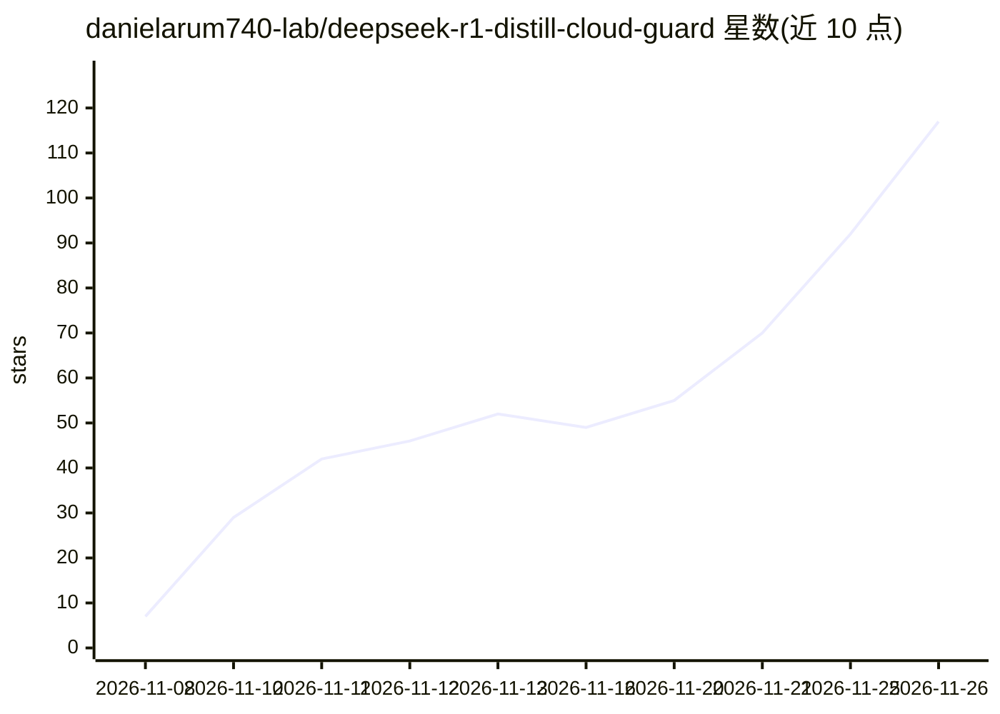

# danielarum740-lab/deepseek-r1-distill-cloud-guard

⭐ 117 · 推送 2026-11-06 · [GitHub](https://github.com/danielarum740-lab/deepseek-r1-distill-cloud-guard) · [官网](https://app.coregold.io/signup?invite_code=ADvlj9b) · 组织维护 · 中文 README

**海外 GPU 租用扣费熔断方案：CoreGold 商用卡限额止损**

面向在 RunPod、Lambda Labs、Together AI 等平台租用 GPU 部署 DeepSeek-R1/V3 的开发者，提供 CoreGold 商用虚拟卡的接入流程：以 USDT 充值底池、按任务派发带单卡硬限额的机器专卡、配套北美英文 AVS 账单地址，实例跑飞时由卡限额触发拒绝并使平台自动停机。README 为指南/营销文档形式，描述自动充值扣费与验资拦截问题，未提供可安装的代码或脚本。

## 筛选速览

| 维度 | 判定 | 备注 |
|---|---|---|
| AI 角色 | `ai-enhanced` | 去掉 AI 部分产品仍成立 |
| 许可风险 | `none` | — |
| 部署形态 | `None` |  |
| 模型依赖 | — | README 未给出锁定关系 |
| 硬件要求 | — | 无带数字的原话,不猜 |
| 安装摩擦 | `low` | 无编译、无系统依赖或容器化 |
| 成熟度 | — | 结构信号不足 |

## 能力要点

- USDT 充值底池并按任务派发带硬限额的商用卡
- 配套北美英文 AVS 账单地址以通过平台核验
- 测试完毕一键销卡，残额退回母池

## 适用场景

- 在海外算力平台部署 DeepSeek 模型时控制扣费上限
- 避免实例忘记释放导致信用卡被连续扣费
- 应对平台对非北美地址卡片的 AVS 拦截

## 场景标签

 · 领域:云算力支付/风控

## 证据(README 行号)

> L20: + 挂载 CoreGold 独立商用卡:
> L21: 算力实例跑飞 / 忘记释放 -> 费用达到单卡限额（如 $60） -> CoreGold 底层强制拒绝（Decline） -> 平台自动停机止损，财务风险完全受控
> L29: 👉 **立即进入 CoreGold 开卡控制台**

## 星数曲线

2026-11-08 7 → 2026-11-26 117（+110）

---
*卡片 v1 · prompt 1.4 · 生成 2026-11-18 · 置信度 mid · 依据 README sha `c1352b374f8a` · [字段定义](../../DATASET.md)*
