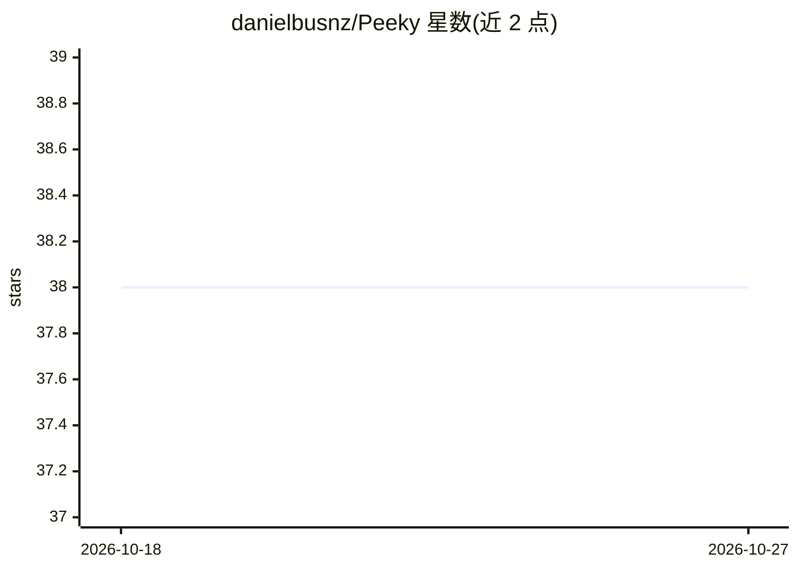

# danielbusnz/Peeky

⭐ 38 · Rust · MIT · 推送 2026-10-21 · [GitHub](https://github.com/danielbusnz/Peeky) · [官网](https://getpeeky.ai) · 个人维护

**语音控制的 AI 光标助手：看屏幕、点击、打字、执行多步任务**

受 Clicky 启发的 Rust 桌面语音助手：按住热键提问后，Peeky 截屏、经 Claude 完成指认/点击/输入/滚动及多步 agent 任务，拥有独立于用户光标的可视光标；可直连 Gmail/Spotify/GitHub/YouTube，跨会话记忆存于本地 JSONL。意图路由采用设备端 ONNX/BERT 混合分类器（关键词优先、LLM 兜底），语音用 Deepgram STT 与 Cartesia TTS。macOS 可下载安装包，Linux（Hyprland/X11）需从源码构建，默认经托管 Cloudflare Worker 代理，也可自带 API key 直连。

## 筛选速览

| 维度 | 判定 | 备注 |
|---|---|---|
| AI 角色 | `ai-native` | 本体是模型或模型工具 |
| 许可风险 | `permissive` | MIT |
| 部署形态 | `desktop` | 安装包/桌面程序 |
| 模型依赖 | locked-api |  |
| 硬件要求 | — | 无带数字的原话,不猜 |
| 安装摩擦 | `low` | 无编译、无系统依赖或容器化 |
| 成熟度 | `idea` | |

## 能力要点

- 五路径意图路由：find_action/integration/chat/memory/agent，设备端 ONNX 分类器+LLM 兜底
- 独立可视光标，操作前可预览每一步
- 直连 Spotify/Gmail/GitHub/YouTube 服务 API，本地 JSONL 跨会话记忆
- 支持自带 Anthropic/Deepgram/Cartesia key 直连，绕过代理

## 适用场景

- 按住热键用语音让 AI 代为点击、输入和滚动
- 执行多步桌面操作链（如打开网站搜索并播放）
- 语音查询日程、邮件、PR 等外部服务信息

## 场景标签

`语音 Agent` `GUI 自动化` · 领域:效率与自动化

## 证据(README 行号)

> L12:  Hold the hotkey. Ask a question. Peeky handles the rest.
> L18: Clicky proved the idea: a small AI that sits next to your cursor, sees your screen, and points at things. I wanted 
> L20: Then I gave it hands. Clicky points. Peeky points, clicks, types, scrolls, and runs multi-step tasks. It also remem

## 星数曲线

2026-10-18 38 → 2026-10-27 38（+0）

---
*卡片 v1 · prompt 1.4 · 生成 2026-10-25 · 置信度 high · 依据 README sha `051d8bc9b468` · [字段定义](../../DATASET.md)*
