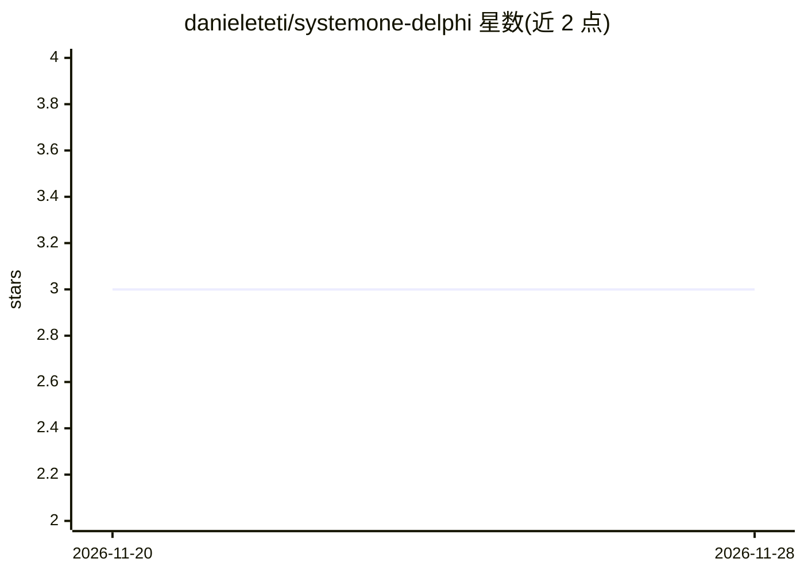

# danieleteti/systemone-delphi

⭐ 3 · Pascal · Apache-2.0 · 推送 2026-10-20 · [GitHub](https://github.com/danieleteti/systemone-delphi) · [官网](https://www.danieleteti.it/systemone-delphi/) · 个人维护

**Delphi 开发者的 System One 分类模型客户端，文本决策毫秒返回**

单个 RTL-only 单元构成的 Delphi 客户端，向 System One 模型（TypeSafe Jev API 或本地 Ollama 上的 tev1/nimble）发送文本状态与类型化问题，返回选项、各选项概率与置信度，无需解析生成文本。提供 Choice/Score/Noul 三种问题类型，另一实现可对接任意 OpenAI 兼容 chat 模型作前置测试。测试覆盖 Delphi 12/13 Win32，离线套件 36 项、在线套件 15 项；图像与 box 题型暂不支持，Jev 真实 API 尚未实测。

## 筛选速览

| 维度 | 判定 | 备注 |
|---|---|---|
| AI 角色 | `ai-native` | 本体是模型或模型工具 |
| 许可风险 | `permissive` | Apache-2.0 |
| 部署形态 | `None` |  |
| 模型依赖 | local-ok | 支持本地模型 |
| 硬件要求 | — | 无带数字的原话,不猜 |
| 安装摩擦 | `low` | 无编译、无系统依赖或容器化 |
| 成熟度 | `idea` | |

## 能力要点

- 三种类型化问题（Choice/Score/Noul）返回值、概率与置信度，无需解析文本
- 同一接口双实现：System One API/Ollama 或任意 OpenAI 兼容 chat 模型
- 无外部依赖，单单元仅用 RTL 的 System.JSON 与 System.Net.HttpClient
- 离线 36 项 + 在线 15 项测试套件（含 fake server）

## 适用场景

- 把工单、邮件、聊天消息路由到正确的团队
- 区分投诉/提问/攻击等消息类别
- 在调用大 LLM 前判断该消息是否需要大模型处理
- 对助手动作做前置门控（如是否要求发送内容）

## 场景标签

 · 领域:机器学习/文本分类

## 证据(README 行号)

> L10: A **System One model** does not write text, it *decides*. You give it a piece of text (the *state*) and a few typed
> L38: - **One interface, two implementations.** `ISystemOneClient.Ask` is answered by `TSystemOneClient` (the System One 
> L39: - **Three question types.** `Choice` (one label among several), `Score` (a level on an ordered scale), `Noul` (a ye

## 星数曲线

2026-11-20 3 → 2026-11-28 3（+0）

---
*卡片 v1 · prompt 1.4 · 生成 2026-11-22 · 置信度 mid · 依据 README sha `0383a323cb2f` · [字段定义](../../DATASET.md)*
