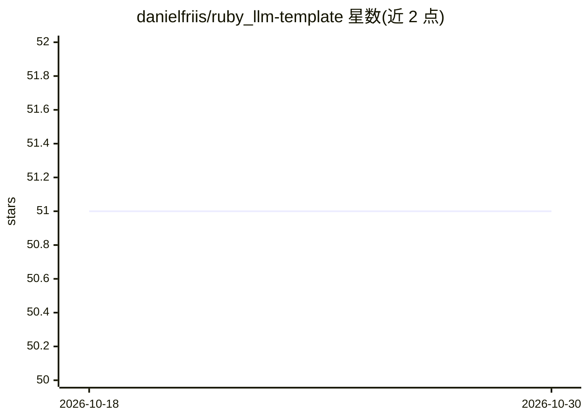

# danielfriis/ruby_llm-template

⭐ 51 · Ruby · MIT · 推送 2026-01-08 · [GitHub](https://github.com/danielfriis/ruby_llm-template) · 个人维护

**为 RubyLLM 组织可复用提示词模板的 Ruby gem**

面向使用 RubyLLM 框架的开发者的 Ruby gem：将提示词按目录组织成模板，每个模板用独立 ERB 文件定义 system/user/assistant 消息与可选的 schema.rb（RubyLLM::Schema DSL 定义结构化输出），通过 chat.with_template 传入上下文变量调用，支持多个模板串联与条件逻辑。提供 Rails 生成器自动配置与非 Rails 应用的手动配置方式。仅依赖 RubyLLM 与 Ruby 标准库；结构化输出仅支持 schema.rb 方式。MIT 许可。

## 筛选速览

| 维度 | 判定 | 备注 |
|---|---|---|
| AI 角色 | `ai-ecosystem` | LLM/agent 周边工具 |
| 许可风险 | `permissive` | MIT |
| 部署形态 | `None` |  |
| 模型依赖 | — | README 未给出锁定关系 |
| 硬件要求 | — | 无带数字的原话,不猜 |
| 安装摩擦 | `low` | 无编译、无系统依赖或容器化 |
| 成熟度 | — | 结构信号不足 |

## 能力要点

- 目录式模板组织：system/user/assistant/schema 分文件定义
- ERB 模板支持上下文变量与 Ruby 条件逻辑
- Rails 生成器一键安装配置（rails generate ruby_llm_template:install）
- 与 RubyLLM::Schema 集成，用 Ruby DSL 替代 JSON 定义输出结构

## 适用场景

- 在 Rails 项目中统一管理各功能的 LLM 提示词
- 为结构化输出任务定义带 schema 的提示词模板
- 多个模板串联构建多轮对话流程

## 场景标签

`提示工程` · 领域:Agent 开发

## 证据(README 行号)

> L7: Organize prompts into easy-to-use templates for RubyLLM.
> L94: chat = RubyLLM.chat

## 星数曲线

2026-10-18 51 → 2026-10-30 51（+0）

---
*卡片 v1 · prompt 1.4 · 生成 2026-10-24 · 置信度 high · 依据 README sha `66763d1c63a3` · [字段定义](../../DATASET.md)*
