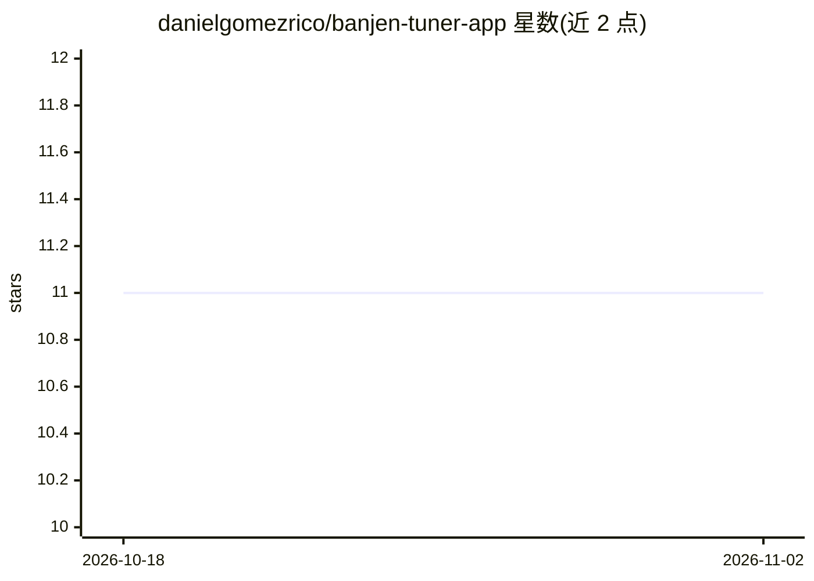

# danielgomezrico/banjen-tuner-app

⭐ 11 · Makefile · MIT · 推送 2026-07-08 · [GitHub](https://github.com/danielgomezrico/banjen-tuner-app) · [官网](https://play.google.com/store/apps/details?id=com.makingiants.android.banjotuner) · 个人维护

**帮助为 4 弦班卓琴调音的 Android 应用**

面向班卓琴演奏者的 Android 调音应用，用于辅助 4 弦班卓琴调弦。README 仅给出功能一句话说明、截图章节、Apache 2.0 许可与作者信息，未描述具体识别机制、安装步骤或依赖；仓库主题标签含 ai，但 README 正文中无可验证的 AI 相关说明。应用通过 Google Play 发布（标题提及）。

## 筛选速览

| 维度 | 判定 | 备注 |
|---|---|---|
| AI 角色 | `ai-enhanced` | 去掉 AI 部分产品仍成立 |
| 许可风险 | `permissive` | MIT |
| 部署形态 | `None` |  |
| 模型依赖 | — | README 未给出锁定关系 |
| 硬件要求 | — | 无带数字的原话,不猜 |
| 安装摩擦 | `low` | 无编译、无系统依赖或容器化 |
| 成熟度 | — | 结构信号不足 |

## 能力要点

- 面向 4 弦班卓琴的调音辅助应用
- 通过 Google Play 发布（README 标题提及）
- 采用 Apache 2.0 许可

## 适用场景

- 为 4 弦班卓琴调弦时使用手机辅助调音

## 场景标签

 · 领域:音乐/移动应用

## 证据(README 行号)

> L5: Android app to help to tune a 4 string banjo

## 星数曲线

2026-10-18 11 → 2026-11-02 11（+0）

---
*卡片 v1 · prompt 1.4 · 生成 2026-11-02 · 置信度 low · 依据 README sha `372df1b83fda` · [字段定义](../../DATASET.md)*
