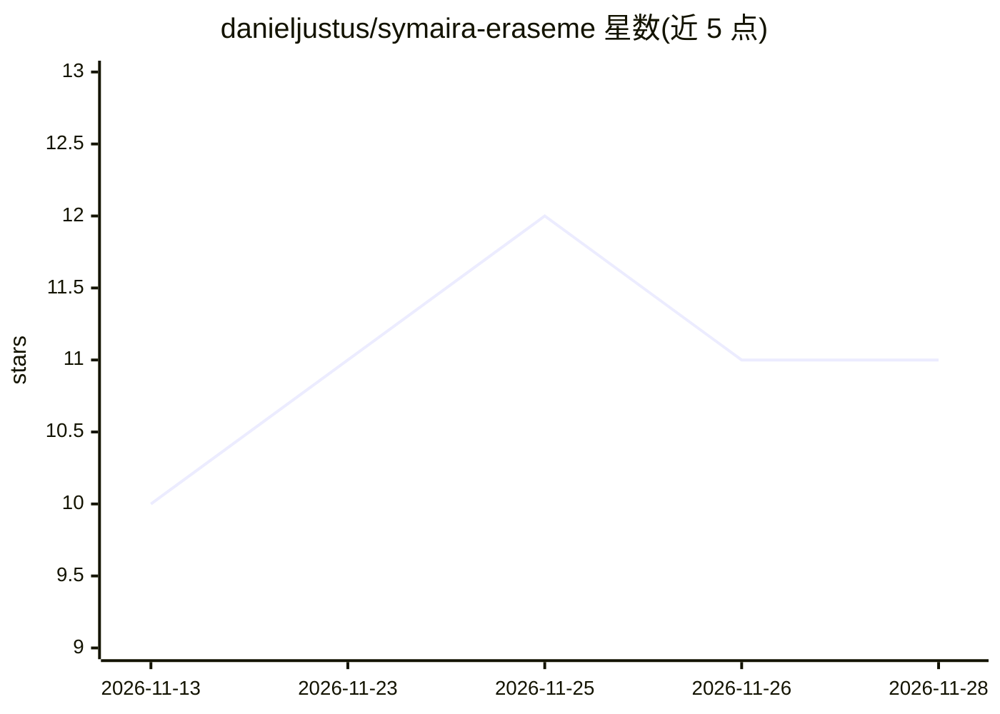

# danieljustus/symaira-eraseme

⭐ 11 · Rust · Apache-2.0 · 推送 2026-11-27 · [GitHub](https://github.com/danieljustus/symaira-eraseme) · [官网](https://symaira.com) · 个人维护

**行使 GDPR/CCPA 删除权、向数据中介发起数据删除请求的本地 CLI 工具**

本地优先的 Rust CLI，附带 SwiftUI macOS 应用与带鉴权的 MCP JSON-RPC 接口，帮助用户对数据中介行使 GDPR/CCPA 删除权。内置 1,200+ 数据中介注册表（含司法辖区与法律元数据），采用事件溯源 SQLite 存储与审计轨迹，提供画像设置、计划生成、执行、收件箱分诊、反驳与报告等 CLI 命令；共享 Rust LLM 供应商层用于回复分类与反驳生成；本地 MCP 服务器编目 26 个工具，Bearer 令牌鉴权。销毁操作需显式同意，部分中介流程仍需人工处理。状态为 Beta。

## 筛选速览

| 维度 | 判定 | 备注 |
|---|---|---|
| AI 角色 | `ai-enhanced` | 去掉 AI 部分产品仍成立 |
| 许可风险 | `permissive` | Apache-2.0 |
| 部署形态 | `None` |  |
| 模型依赖 | — | README 未给出锁定关系 |
| 硬件要求 | — | 无带数字的原话,不猜 |
| 安装摩擦 | `low` | 无编译、无系统依赖或容器化 |
| 成熟度 | `idea` | |

## 能力要点

- 1,200+ 数据中介注册表，含司法辖区与法律元数据
- 本地 MCP HTTP JSON-RPC 服务器，26 个编目工具，Bearer 令牌鉴权
- AES-256-GCM 加密身份档案与 Fernet 加密数据库，销毁操作需显式同意
- 共享 Rust LLM 供应商层用于回复分类与反驳生成

## 适用场景

- 批量向数据中介提交数据删除请求并跟踪期限
- 对中介的回复自动分类并生成反驳
- 通过 MCP 客户端以工具形式调用删除工作流

## 场景标签

 · 领域:隐私/数据权利工具

## 证据(README 行号)

> L13: Symaira EraseMe helps you exercise your GDPR/CCPA right to erasure against
> L45: - Shared Rust LLM provider layer for reply classification and rebuttal generation.
> L46: - Local MCP HTTP JSON-RPC server with 26 catalogued tools and Bearer-token auth.

## 星数曲线

2026-11-13 10 → 2026-11-28 11（+1）

---
*卡片 v1 · prompt 1.4 · 生成 2026-11-19 · 置信度 high · 依据 README sha `1966b4741d5c` · [字段定义](../../DATASET.md)*
