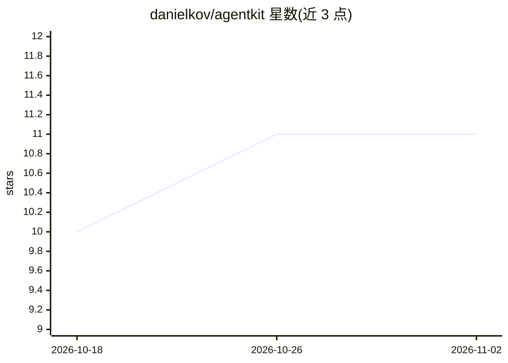

# danielkov/agentkit

⭐ 11 · Rust · MIT · 推送 2026-10-30 · [GitHub](https://github.com/danielkov/agentkit) · [官网](https://danielkov.github.io/agentkit/) · 个人维护

**Rust 的 LLM agent 应用构建工具包：编码代理、CLI 助手、多代理工具**

面向 Rust 开发者的 LLM agent 框架，按功能拆分为 feature flag 控制的小 crate：核心会话循环、工具与权限、MCP 集成、ACP 协议、上下文加载（AGENTS.md/skills）、压缩策略、异步任务调度、内置文件系统与 shell 工具。提供 OpenRouter/OpenAI/Anthropic/Baseten/Cerebras/Ollama/vLLM/Groq/Mistral 多个 provider 适配器，统一认证与可选重试。附多个从最小聊天到多代理编排的示例工程，通过 cargo 运行。

## 筛选速览

| 维度 | 判定 | 备注 |
|---|---|---|
| AI 角色 | `ai-ecosystem` | LLM/agent 周边工具 |
| 许可风险 | `permissive` | MIT |
| 部署形态 | `library` | 以包/库形式分发 |
| 模型依赖 | local-ok | 支持本地模型 |
| 硬件要求 | — | 无带数字的原话,不猜 |
| 安装摩擦 | `low` | 无编译、无系统依赖或容器化 |
| 成熟度 | — | 结构信号不足 |

## 能力要点

- 约 20 个 feature-gated 子 crate，按需引入
- MCP 集成（stdio + Streamable HTTP）与 Agent Client Protocol 支持
- 9 个 provider 适配器（含本地 Ollama/vLLM），统一认证与可选重试/超时
- 内置文件系统与 shell 工具，支持路径权限策略与 read-before-write 强制

## 适用场景

- 用 Rust 构建编码代理或 CLI 助手
- 搭建通过 MCP 调用外部工具的 agent
- 实现多代理协作（编排者/工作者/审查者）或上下文压缩流程

## 场景标签

`Agent 框架` `多智能体` · 领域:Agent 开发

## 证据(README 行号)

> L11: `agentkit` is a Rust toolkit for building LLM agent applications such as coding agents, assistant CLIs, and multi-a
> L13: The project is split into small crates behind feature flags so hosts can pull in only the pieces they need.

## 星数曲线

2026-10-18 10 → 2026-11-02 11（+1）

---
*卡片 v1 · prompt 1.4 · 生成 2026-11-02 · 置信度 high · 依据 README sha `dc402ef13b7c` · [字段定义](../../DATASET.md)*
