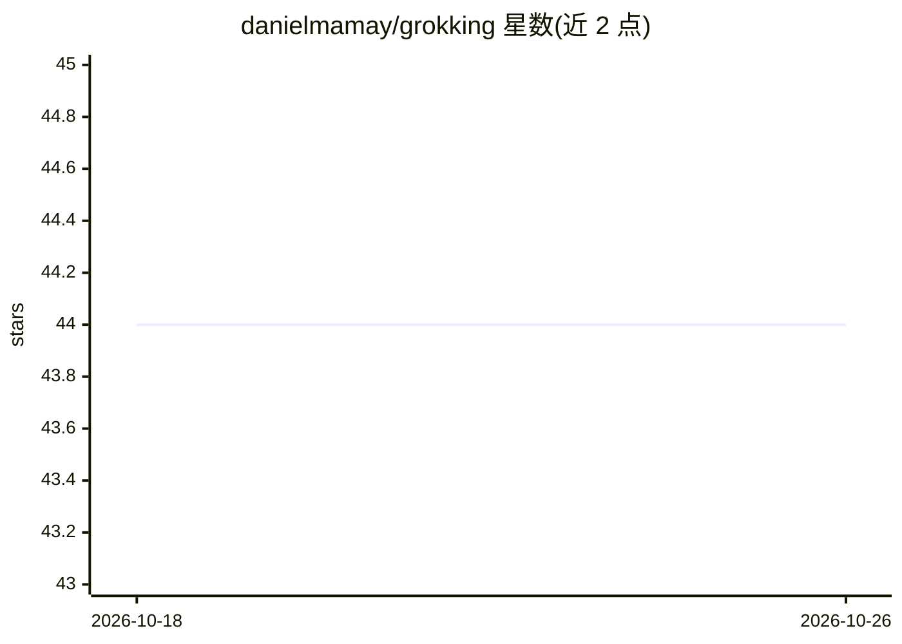

# danielmamay/grokking

⭐ 44 · Python · MIT · 推送 2026-05-02 · [GitHub](https://github.com/danielmamay/grokking) · 个人维护

**PyTorch 复现 Grokking 论文：小算法数据集上的泛化实验**

用 PyTorch 实现 OpenAI 论文《Grokking: Generalization Beyond Overfitting on Small Algorithmic Datasets》，面向深度学习研究者复现和探索 grokking 现象。通过 git clone 获取源码，uv 管理依赖；提供 CLI 运行单个实验，并集成 Weights & Biases 记录实验与网格搜索（Sweeps），支持 pyright 类型检查与 ruff 代码检查。README 未展示模型输出形式的细节或硬件要求。

## 筛选速览

| 维度 | 判定 | 备注 |
|---|---|---|
| AI 角色 | `ai-native` | 本体是模型或模型工具 |
| 许可风险 | `permissive` | MIT |
| 部署形态 | `None` |  |
| 模型依赖 | — | README 未给出锁定关系 |
| 硬件要求 | — | 无带数字的原话,不猜 |
| 安装摩擦 | `low` | 无编译、无系统依赖或容器化 |
| 成熟度 | — | 结构信号不足 |

## 能力要点

- PyTorch 实现论文的 grokking 现象实验
- CLI 运行单个实验
- 集成 Weights & Biases 实验跟踪与 Sweeps 网格搜索

## 适用场景

- 复现 grokking 泛化论文实验
- 基于 W&B Sweeps 做超参网格搜索
- 研究小算法数据集上的泛化与过拟合行为

## 场景标签

`科研工具` · 领域:学习与行业

## 证据(README 行号)

> L3: An implementation of the OpenAI 'Grokking: Generalization Beyond Overfitting on Small Algorithmic Datasets' paper in
> L21: * To run a single experiment using the CLI:

## 星数曲线

2026-10-18 44 → 2026-10-26 44（+0）

---
*卡片 v1 · prompt 1.4 · 生成 2026-10-25 · 置信度 high · 依据 README sha `d47934b5377a` · [字段定义](../../DATASET.md)*
