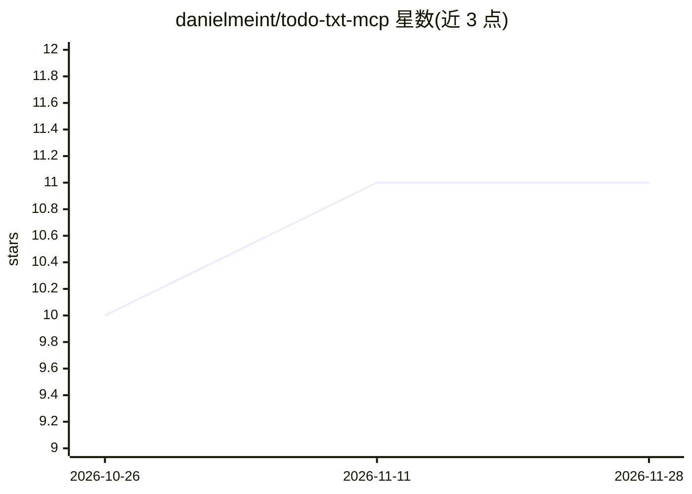

# danielmeint/todo-txt-mcp

⭐ 11 · Python · MIT · 推送 2026-01-20 · [GitHub](https://github.com/danielmeint/todo-txt-mcp) · [官网](https://pypi.org/project/todo-txt-mcp/) · 个人维护

**将 todo.txt 接入 AI 助手的 MCP 服务器**

基于 Model Context Protocol 的服务器，将 todo.txt 纯文本任务文件接入 Claude Desktop 等 AI 助手，使用户通过自然语言管理任务。提供 10 个工具，覆盖待办的增删改查、按文本搜索、按优先级/项目/上下文过滤及统计；完整兼容 todo.txt 规范，支持自定义文件路径、自动检测 todo.sh 配置，并提供备份开关与文件大小上限等环境变量。通过 uv 或 pip 安装，需 Python 3.10+，MIT 许可。

## 筛选速览

| 维度 | 判定 | 备注 |
|---|---|---|
| AI 角色 | `ai-ecosystem` | LLM/agent 周边工具 |
| 许可风险 | `permissive` | MIT |
| 部署形态 | `library` | 以包/库形式分发 |
| 模型依赖 | — | README 未给出锁定关系 |
| 硬件要求 | — | 无带数字的原话,不猜 |
| 安装摩擦 | `low` | 无编译、无系统依赖或容器化 |
| 成熟度 | — | 结构信号不足 |

## 能力要点

- 10 个 MCP 工具：增删改查、搜索、按优先级/项目/上下文过滤与统计
- 完全兼容 todo.txt 规范，保留纯文本的可移植性
- 自动检测 todo.sh 配置，支持自定义文件路径与备份开关

## 适用场景

- 在 Claude Desktop 中用自然语言添加和完成待办
- 让 AI 按优先级、项目或上下文筛选任务并生成统计
- 保持现有 todo.txt 工作流不变的前提下接入 AI 助手

## 场景标签

 · 领域:生产力/任务管理

## 证据(README 行号)

> L7: A Model Context Protocol server that connects todo.txt files
> L60: |Tool|Description|

## 星数曲线

2026-10-26 10 → 2026-11-28 11（+1）

---
*卡片 v1 · prompt 1.4 · 生成 2026-11-18 · 置信度 high · 依据 README sha `439381084f43` · [字段定义](../../DATASET.md)*
