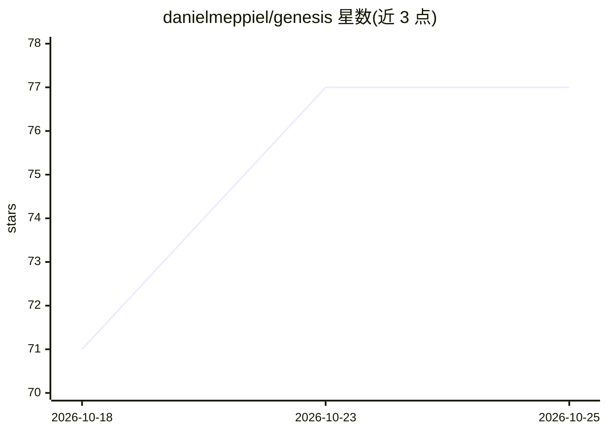

# danielmeppiel/genesis

⭐ 77 · Python · Apache-2.0 · 推送 2026-05-30 · [GitHub](https://github.com/danielmeppiel/genesis) · [官网](https://danielmeppiel.github.io/genesis/) · 个人维护

**面向 AI 编码 agent 的架构设计技能：命名模式与契约的知识库**

以 SKILL.md 形式交付的架构层知识库：将软件架构师的角色移植到 LLM 驱动的多 agent 系统，提供 6 个通用原语命名、23 个设计模式、9 个架构模式与 4 个重构模式（含 GoF 映射与 Attention Anchor 等 LLM 特有模式），在被调用时产出命名模式、执行图、验收测试与设计计划。通过 npx skills add 安装，兼容 Claude Code、Cursor、Codex、OpenCode、GitHub Copilot 等 41+ 种 agent 运行时，各运行时以文件名适配。Apache 2.0 许可，配套长文书为 CC BY-NC 4.0。

## 筛选速览

| 维度 | 判定 | 备注 |
|---|---|---|
| AI 角色 | `ai-knowledge` | 知识聚合/清单类 |
| 许可风险 | `permissive` | Apache-2.0 |
| 部署形态 | `library` | 以包/库形式分发 |
| 模型依赖 | — | README 未给出锁定关系 |
| 硬件要求 | — | 无带数字的原话,不猜 |
| 安装摩擦 | `low` | 无编译、无系统依赖或容器化 |
| 成熟度 | — | 结构信号不足 |

## 能力要点

- 命名 6 个跨运行时通用原语（Persona Scoping File、Module Entrypoint 等）
- 23 设计模式 + 9 架构模式 + 4 重构模式的目录，含 GoF 映射
- 调用后先产出命名模式、执行图、验收测试与书面计划，再动文件
- 5 种运行时（Claude Code/Copilot/Cursor/OpenCode/Codex）适配表

## 适用场景

- 在写 agent skill 之前先做架构分解与契约设计
- 把膨胀的单体指令文件按模式重构为模块化 skill
- 让多 lens PR 审查等系统按既定模式生成执行结构

## 场景标签

`提示工程` · 领域:Agent 开发

## 证据(README 行号)

> L137: Full catalogue (23 design patterns + 9 architectural patterns + 4 refactor patterns): `skills/genesis/assets/desig
> L167: - `skills/genesis/assets/` -- the loadable knowledge base (primitives, patterns, anti-patterns, refactor moves, ru

## 星数曲线

2026-10-18 71 → 2026-10-25 77（+6）

---
*卡片 v1 · prompt 1.4 · 生成 2026-10-24 · 置信度 high · 依据 README sha `ce5e995ba361` · [字段定义](../../DATASET.md)*
