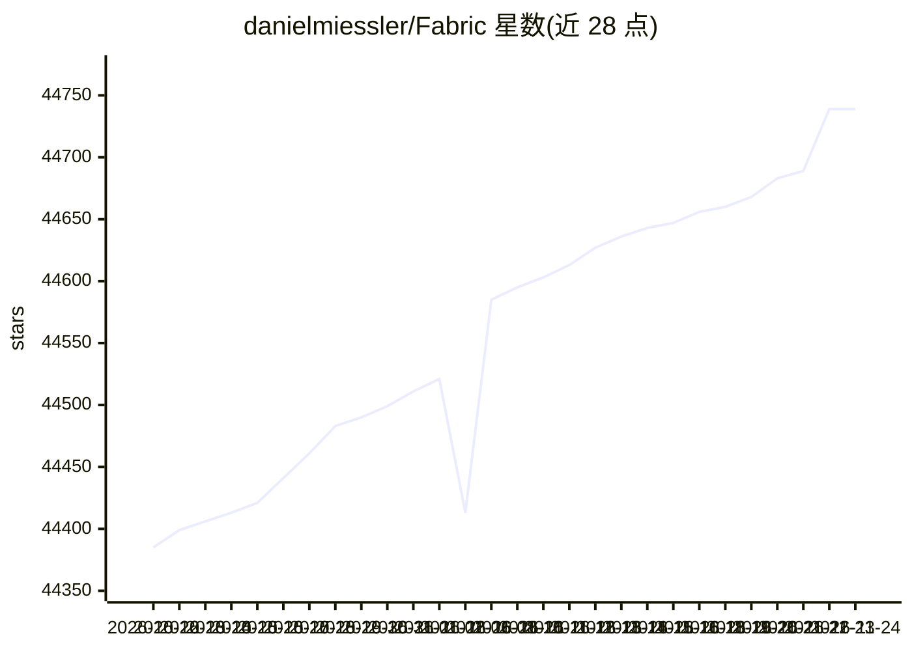

# danielmiessler/Fabric

⭐ 44,755 · Go · MIT · 推送 2026-11-23 · [GitHub](https://github.com/danielmiessler/Fabric) · [官网](https://danielmiessler.com/p/fabric-origin-story) · 个人维护

**为命令行用户组织 AI 提示词并可接入多家模型的框架**

Fabric 以开源框架形式组织提示词（Patterns），按真实任务分类管理，用户可在自己的常用工具中调用这些提示，或直接通过 Fabric 的命令行界面使用。它支持原生接入多家 AI 服务商，也支持大量 OpenAI 兼容接口的服务商，通过 `fabric --setup` 配置 API key，并提供 REST API 服务器、每个 Pattern 独立映射模型的环境变量、模式别名为 shell 命令等机制。安装覆盖一键脚本、二进制包、多平台包管理器、Go 源码与 Docker 镜像，支持 x86/ARM 的 macOS/Linux/Windows。

## 筛选速览

| 维度 | 判定 | 备注 |
|---|---|---|
| AI 角色 | `ai-ecosystem` | LLM/agent 周边工具 |
| 许可风险 | `permissive` | MIT |
| 部署形态 | `self-host` | docker 或自建部署 |
| 模型依赖 | local-ok | 支持本地模型 |
| 硬件要求 | — | 无带数字的原话,不猜 |
| 安装摩擦 | `low` | 无编译、无系统依赖或容器化 |
| 成熟度 | — | 结构信号不足 |

## 动量与使用信号

- 维护:`active` — 距上次 push 1.7 天,年发版 100,252 位贡献者
- 涨星:近 1 天 **+28**(自 20261016 起算)
- 下载:GitHub Release 附件 累计 76,472(100 个 release)
- 平台:WINDOWS / MACOS / LINUX · 协议:OPENAI-API / OLLAMA

## 能力要点

- 以 Patterns（提示词）为基本单位，按任务组织并可自建/收集
- 原生接入 OpenAI、Anthropic、Gemini、Ollama、Bedrock 等服务商，另支持数十家 OpenAI 兼容服务商
- 提供 REST API 服务器与 Swagger/OpenAPI 文档界面
- 支持 OpenAI 语音转文字的 `--transcribe-file` 等转写功能

## 适用场景

- 在命令行里对任意输入套用现成 Pattern（如总结、提炼要点）
- 把自己常用的提示词集中管理并在多个工具中复用
- 通过 REST API 把提示词能力接入其他工具
- 在 Raspberry Pi 等 ARM 设备上运行（提供 ARM 二进制）

## 场景标签

`提示工程` `AI 助手` · 领域:Agent 开发

## 证据(README 行号)

> L22:  <code>fabric</code> is an open-source framework for augmenting humans using AI.
> L50: **Fabric was created to address this by creating and organizing the fundamental units of AI—the prompts themselves!
> L253: Fabric supports a wide range of AI providers:

## 星数曲线

2026-10-22 44,385 → 2026-11-24 44,739（+354）

---
*卡片 v1 · prompt 1.4 · 生成 2026-11-22 · 置信度 high · 依据 README sha `9fa7f511e762` · [字段定义](../../DATASET.md)*
