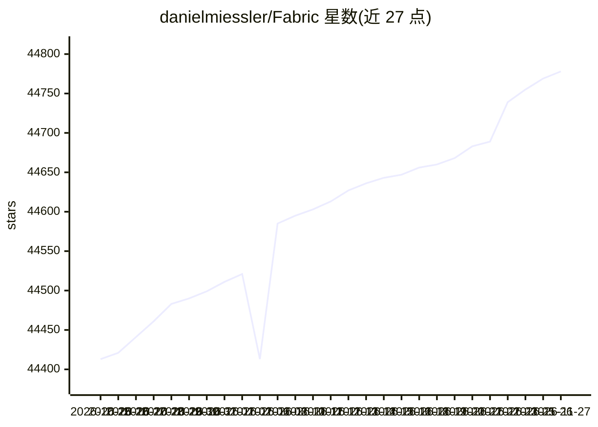

# danielmiessler/Fabric

⭐ 44,778 · Go · MIT · 推送 2026-11-25 · [GitHub](https://github.com/danielmiessler/Fabric) · [官网](https://danielmiessler.com/p/fabric-origin-story) · 个人维护

**开源 AI 提示词框架：组织 Pattern 供命令行与工具调用**

Fabric 是一个用 AI 增强人类工作流的开源框架，核心机制是把众包的 AI 提示词（Patterns）按真实任务组织，供用户在自己的工具中调用，命令行用户可直接以 fabric 作为接口。支持多厂商模型接入（原生集成与 OpenAI 兼容两类后端）、按 Pattern 配置模型映射、为所有 Pattern 生成命令别名，并提供 REST API 与 Swagger 文档。提供多平台安装包、Docker 镜像与源码安装方式，界面支持 10 种语言。适用于希望在命令行中统一管理和调用提示词的用户。

## 筛选速览

| 维度 | 判定 | 备注 |
|---|---|---|
| AI 角色 | `ai-ecosystem` | LLM/agent 周边工具 |
| 许可风险 | `permissive` | MIT |
| 部署形态 | `self-host` | docker 或自建部署 |
| 模型依赖 | local-ok | 支持本地模型 |
| 硬件要求 | — | 无带数字的原话,不猜 |
| 安装摩擦 | `low` | 无编译、无系统依赖或容器化 |
| 成熟度 | — | 结构信号不足 |

## 动量与使用信号

- 维护:`active` — 距上次 push 1.7 天,年发版 100,252 位贡献者
- 涨星:近 1 天 **+28**(自 20261016 起算)
- 下载:GitHub Release 附件 累计 76,472(100 个 release)
- 平台:WINDOWS / MACOS / LINUX · 协议:OPENAI-API / OLLAMA

## 能力要点

- 按真实任务组织的众包提示词集合（Patterns），可在 CLI 中直接调用
- 原生集成多家 AI 提供商，另支持大量 OpenAI 兼容后端
- 按 Pattern 的模型映射与全 Pattern 命令别名机制
- 提供 REST API 与 Swagger 交互式文档，支持 10 种语言

## 适用场景

- 在命令行中用统一的 Pattern 调用不同厂商模型完成任务
- 收集、整理并版本化自己常用的 AI 提示词
- 提取 YouTube 视频与播客的核心内容或摘要长文
- 通过 REST API 把 Patterns 集成到自己的工具中

## 场景标签

`提示工程` `AI 写作` · 领域:Agent 开发

## 证据(README 行号)

> L22:  <code>fabric</code> is an open-source framework for augmenting humans using AI.
> L50: **Fabric was created to address this by creating and organizing the fundamental units of AI—the prompts themselves!
> L52: Fabric organizes prompts by real-world task, allowing people to create, collect, and organize their most important 

## 星数曲线

2026-10-25 44,413 → 2026-11-27 44,778（+365）

---
*卡片 v1 · prompt 1.4 · 生成 2026-11-26 · 置信度 high · 依据 README sha `e35d412638c5` · [字段定义](../../DATASET.md)*
