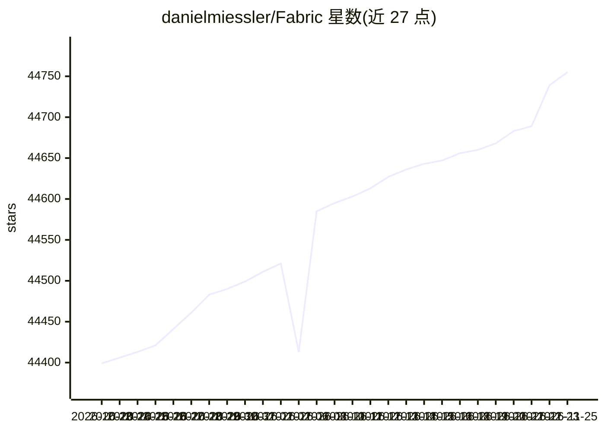

# danielmiessler/Fabric

⭐ 44,755 · Go · MIT · 推送 2026-11-23 · [GitHub](https://github.com/danielmiessler/Fabric) · [官网](https://danielmiessler.com/p/fabric-origin-story) · 个人维护

**用众包 AI 提示词解决具体任务的命令行框架**

Fabric 是一个开源框架，将 AI 提示词（Patterns）作为基本单元组织：按真实世界任务分类收集、创建与管理提示，可在命令行界面直接调用，也可集成到用户已有工具中。功能覆盖内容摘要、写作、代码解释等场景，内置 REST API 与 Web 交互界面，支持多供应商配置与按 Pattern 映射模型。安装提供一行脚本、二进制包、brew/winget/scoop/AUR 等包管理器、Go 源码安装及 Docker 镜像。

## 筛选速览

| 维度 | 判定 | 备注 |
|---|---|---|
| AI 角色 | `ai-native` | 本体是模型或模型工具 |
| 许可风险 | `permissive` | MIT |
| 部署形态 | `self-host` | docker 或自建部署 |
| 模型依赖 | local-ok | 支持本地模型 |
| 硬件要求 | — | 无带数字的原话,不猜 |
| 安装摩擦 | `low` | 无编译、无系统依赖或容器化 |
| 成熟度 | — | 结构信号不足 |

## 动量与使用信号

- 维护:`active` — 距上次 push 1.7 天,年发版 100,252 位贡献者
- 涨星:近 1 天 **+28**(自 20261016 起算)
- 下载:GitHub Release 附件 累计 76,472(100 个 release)
- 平台:WINDOWS / MACOS / LINUX · 协议:OPENAI-API / OLLAMA

## 能力要点

- 按任务组织的众包提示词库（Patterns），可作为 shell 别名直接调用
- 原生接入多家 AI 供应商，另支持大量 OpenAI 兼容后端
- 提供 REST API 与 Swagger/OpenAPI 交互文档
- 一行安装脚本、多平台二进制（含 ARM）与 Docker 镜像分发

## 适用场景

- 在命令行中对 YouTube 视频和播客提取要点或摘要
- 收集并版本化自己常用的提示词，跨工具复用
- 通过 `--transcribe-file` 做语音转文字
- 按任务为不同 Pattern 指定不同的供应商与模型

## 场景标签

`提示工程` `AI 写作` `语音识别` · 领域:Agent 开发

## 证据(README 行号)

> L22:  <code>fabric</code> is an open-source framework for augmenting humans using AI.
> L50: **Fabric was created to address this by creating and organizing the fundamental units of AI—the prompts themselves!
> L253: Fabric supports a wide range of AI providers:

## 星数曲线

2026-10-23 44,399 → 2026-11-25 44,755（+356）

---
*卡片 v1 · prompt 1.4 · 生成 2026-11-25 · 置信度 high · 依据 README sha `cc3274f573dd` · [字段定义](../../DATASET.md)*
