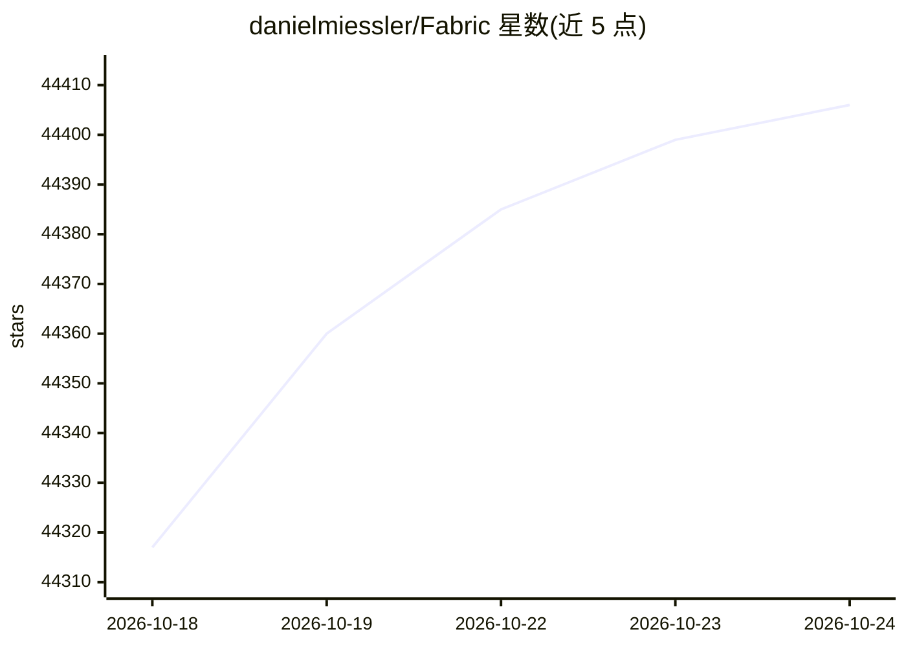

# danielmiessler/Fabric

⭐ 44,406 · Go · MIT · 推送 2026-10-23 · [GitHub](https://github.com/danielmiessler/Fabric) · [官网](https://danielmiessler.com/p/fabric-origin-story) · 个人维护

**面向命令行用户的 AI 提示词组织与调用框架**

开源 AI 框架，将提示词组织为 Patterns（按现实任务分类的可复用单元），供用户在各工具中调用，也可作为命令行界面直接使用。覆盖提取视频要点、写文章、摘要论文、生成总结等任务场景。提供 Go 实现与 REST API，支持 10 余种原生接入的 AI 提供商及数十家 OpenAI 兼容供应商，配置按 Pattern 映射模型。安装覆盖脚本、二进制、多包管理器与 Docker。

## 筛选速览

| 维度 | 判定 | 备注 |
|---|---|---|
| AI 角色 | `ai-native` | 本体是模型或模型工具 |
| 许可风险 | `permissive` | MIT |
| 部署形态 | `self-host` | docker 或自建部署 |
| 模型依赖 | local-ok | 支持本地模型 |
| 硬件要求 | — | 无带数字的原话,不猜 |
| 安装摩擦 | `low` | 无编译、无系统依赖或容器化 |
| 成熟度 | — | 结构信号不足 |

## 动量与使用信号

- 维护:`active` — 距上次 push 1.7 天,年发版 100,252 位贡献者
- 涨星:近 1 天 **+28**(自 20261016 起算)
- 下载:GitHub Release 附件 累计 76,472(100 个 release)
- 平台:WINDOWS / MACOS / LINUX · 协议:OPENAI-API / OLLAMA

## 能力要点

- 以 Patterns（提示词单元）组织 AI 能力，按任务分类管理
- 原生接入十余家 AI 提供商，另支持数十家 OpenAI 兼容供应商
- 提供 CLI 与 REST API（含 Swagger/OpenAPI 文档）两种使用方式
- 支持按 Pattern 配置模型映射（FABRIC_MODEL_PATTERN_NAME 环境变量）

## 适用场景

- 在命令行中直接调用整理好的提示词完成摘要/写作等任务
- 把常用的 AI 提示词集中收集、版本化管理
- 通过 YouTube/播客转录提取内容要点
- 统一配置多家 AI 供应商并在不同 Pattern 间切换模型

## 场景标签

`提示工程` `AI 写作` · 领域:Agent 开发

## 证据(README 行号)

> L22:  <code>fabric</code> is an open-source framework for augmenting humans using AI.
> L50: **Fabric was created to address this by creating and organizing the fundamental units of AI—the prompts themselves!
> L253: Fabric supports a wide range of AI providers:

## 星数曲线

2026-10-18 44,317 → 2026-10-24 44,406（+89）

---
*卡片 v1 · prompt 1.4 · 生成 2026-10-18 · 置信度 high · 依据 README sha `6a06de459335` · [字段定义](../../DATASET.md)*
