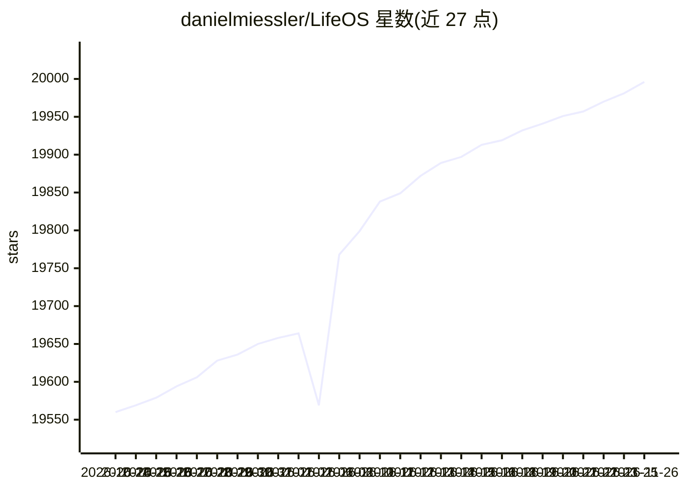

# danielmiessler/LifeOS

⭐ 19,996 · TypeScript · MIT · 推送 2026-11-18 · [GitHub](https://github.com/danielmiessler/LifeOS) · [官网](https://ourlifeos.ai) · 个人维护

**个人 AI 生活操作系统：由 AI 安装的个人 AI harness**

LifeOS 是运行在 AI coding harness（如 Claude Code）之上的通用 AI Harness：通过 TELOS 目标体系、意图工程、持久记忆（Cortex）、技能/Hook 系统、输入路由（Synapse）与自我改进机制，把用户是谁、关心什么、目标何在固化为系统上下文，辅助用户完成工作与生活任务。安装由 AI agent 读取安装页完成，或提供 curl 脚本；需要 bun 运行时。作者声明安全特性在各版本间变动、安全责任由使用者承担。本地模型支持在路线图中，尚未实现。

## 筛选速览

| 维度 | 判定 | 备注 |
|---|---|---|
| AI 角色 | `ai-ecosystem` | LLM/agent 周边工具 |
| 许可风险 | `permissive` | MIT |
| 部署形态 | `None` |  |
| 模型依赖 | — | README 未给出锁定关系 |
| 硬件要求 | — | 无带数字的原话,不猜 |
| 安装摩擦 | `low` | 无编译、无系统依赖或容器化 |
| 成熟度 | — | 结构信号不足 |

## 动量与使用信号

- 维护:`active` — 距上次 push 44.3 天,年发版 21,33 位贡献者
- 涨星:近 1 天 **+24**(自 20261016 起算)
- 下载:GitHub Release 附件 累计 132(28 个 release)
- 平台:MACOS / LINUX · 协议:OLLAMA

## 能力要点

- 内置 97 个公开技能，覆盖研究、安全、写作、视频等领域
- TELOS/Algorithm/ISA 等核心组件实现目标驱动的工作流
- 持久记忆与自我改进：系统按学习结果修改自身
- harness 无关设计，代码为 TypeScript 与 Bash

## 适用场景

- 让 AI 长期记住我的目标、联系人与偏好，无需每次重述
- 在 Claude Code 等 harness 上构建个性化工作流与路由
- 组织个人研究、写作、项目开发等日常任务

## 场景标签

`AI 助手` · 领域:对话与助手

## 证据(README 行号)

> L25: **LifeOS** is a General Purpose AI Harness for doing anything you want to do in life and work with AI. It captures 
> L46: **Give it to your AI.** LifeOS is installed *by* an AI, so the install is just a prompt. Paste this into your AI co
> L90: Any high-end one. LifeOS is harness-agnostic by design — it's built on universal primitives (hooks, skills, context

## 星数曲线

2026-10-24 19,560 → 2026-11-26 19,996（+436）

---
*卡片 v1 · prompt 1.4 · 生成 2026-11-22 · 置信度 high · 依据 README sha `04b0f968b483` · [字段定义](../../DATASET.md)*
