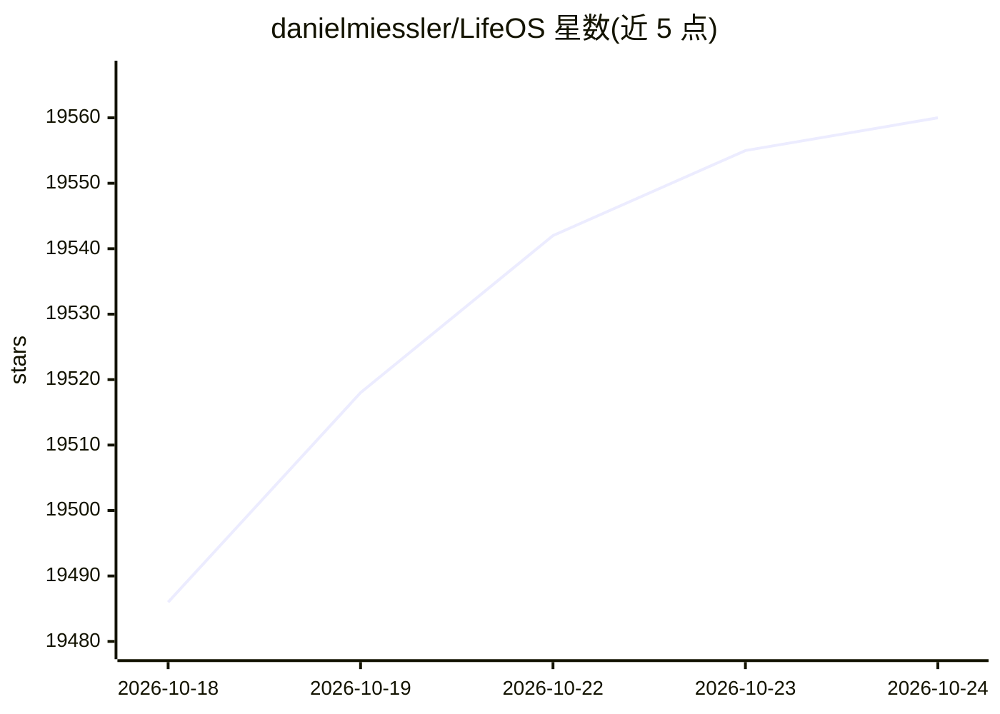

# danielmiessler/LifeOS

⭐ 19,569 · TypeScript · MIT · 推送 2026-09-04 · [GitHub](https://github.com/danielmiessler/LifeOS) · [官网](https://ourlifeos.ai) · 个人维护

**个人 AI 操作系统：让 AI 基于你的上下文推动你达成目标**

LifeOS 是一个通用 AI Harness，以单个自包含 skill 形式分发，安装即向 Claude Code、Cursor、Codex 等 AI 编码代理粘贴一段 prompt 完成配置。系统围绕「从当前状态到理想状态」概念组织，包含持久记忆（Cortex）、49 个技能、hooks、意图路由、七阶段 Algorithm 循环与 TELOS 身份层等组件。代码为 TypeScript 与 Bash，运行依赖 AI coding harness 和 bun，主要在 Claude Code 上测试。

## 筛选速览

| 维度 | 判定 | 备注 |
|---|---|---|
| AI 角色 | `ai-native` | 本体是模型或模型工具 |
| 许可风险 | `permissive` | MIT |
| 部署形态 | `None` |  |
| 模型依赖 | locked-api |  |
| 硬件要求 | — | 无带数字的原话,不猜 |
| 安装摩擦 | `low` | 无编译、无系统依赖或容器化 |
| 成熟度 | — | 结构信号不足 |

## 动量与使用信号

- 维护:`active` — 距上次 push 44.3 天,年发版 21,33 位贡献者
- 涨星:近 1 天 **+24**(自 20261016 起算)
- 下载:GitHub Release 附件 累计 132(28 个 release)
- 平台:MACOS / LINUX · 协议:OLLAMA

## 能力要点

- 通过粘贴 prompt 或 curl 一行命令由 AI 完成安装
- 持久记忆、技能库、智能路由与自我改进机制
- 七阶段 Algorithm 循环并按复杂度分级验证
- 设计为 harness 无关，基于通用原语（hooks、skills、context files）

## 适用场景

- 为个人 AI 助手添加长期记忆与上下文管理
- 在 AI 编码工具上构建个人目标与任务管理系统
- 整合研究、写作、安全等自定义技能到日常工作流

## 场景标签

`Agent 记忆` `AI 助手` · 领域:Agent 开发

## 证据(README 行号)

> L25: **LifeOS** is a General Purpose AI Harness for doing anything you want to do in life and work with AI. It captures 
> L84: Any high-end one. LifeOS is harness-agnostic by design — it's built on universal primitives (hooks, skills, context
> L198: - **Skill-based distribution** — the whole system now ships as a single self-contained skill (`LifeOS/`): the orch

## 星数曲线

2026-10-18 19,486 → 2026-10-24 19,560（+74）

---
*卡片 v1 · prompt 1.4 · 生成 2026-10-18 · 置信度 high · 依据 README sha `109f8329a518` · [字段定义](../../DATASET.md)*
