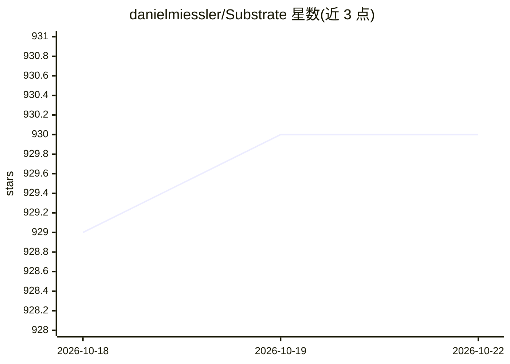

# danielmiessler/Substrate

⭐ 930 · TypeScript · MIT · 推送 2026-10-21 · [GitHub](https://github.com/danielmiessler/Substrate) · [官网](https://www.youtube.com/watch?v=ky7ejowc_qY) · 个人维护

**连接17+知识组件的人类福祉知识库与数据框架**

开源的知识组织框架，用 Problems/Solutions/Arguments/Claims 等 17+ 种结构化组件记录问题、方案与证据，并收录 13 个权威数据源（FRED、CDC WONDER、Census ACS、WHO、世界银行等），覆盖 100+ 年的经济、健康、社会与环境指标。数据以 CSV/Markdown 双格式提供，供人直接浏览和 AI 解析，配套 TypeScript+Bun 自动化脚本与免费 API。面向研究者、OSINT 调查者与公共问责分析者，社区通过结构化格式提交内容。

## 筛选速览

| 维度 | 判定 | 备注 |
|---|---|---|
| AI 角色 | `ai-knowledge` | 知识聚合/清单类 |
| 许可风险 | `permissive` | MIT |
| 部署形态 | `None` |  |
| 模型依赖 | — | README 未给出锁定关系 |
| 硬件要求 | — | 无带数字的原话,不猜 |
| 安装摩擦 | `low` | 无编译、无系统依赖或容器化 |
| 成熟度 | — | 结构信号不足 |

## 能力要点

- 17+ 种结构化知识组件（问题/方案/论证/声明等）
- 13 个权威数据源，含 8 维图书情报学评估编目
- 人类可读与机器可解析的双重格式设计
- TypeScript + Bun 自动化脚本更新数据

## 适用场景

- 交叉核对公共记录与政府数据做调查分析
- 用权威数据源验证声明与论证质量
- 追踪政策承诺到实际结果的问责分析
- 组合多数据源构建福祉指标

## 场景标签

`知识库管理` `数据分析` · 领域:效率与自动化

## 证据(README 行号)

> L46: **An open-source framework connecting 17+ knowledge components:**
> L267: **Everything is designed for dual consumption:**
> L269: - ✅ **Machine-parseable** - Consistent formats AI can query

## 星数曲线

2026-10-18 929 → 2026-10-22 930（+1）

---
*卡片 v1 · prompt 1.4 · 生成 2026-10-21 · 置信度 mid · 依据 README sha `58bf7a0bbfd4` · [字段定义](../../DATASET.md)*
