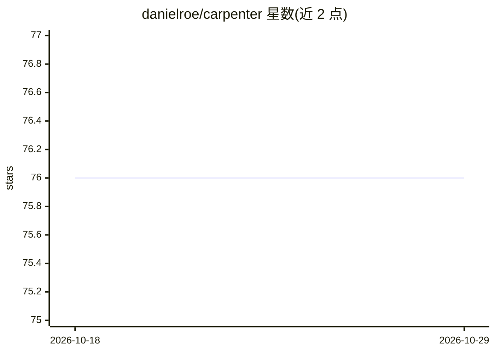

# danielroe/carpenter

⭐ 76 · TypeScript · MIT · 推送 2026-10-28 · [GitHub](https://github.com/danielroe/carpenter) · [官网](https://github.com/nuxt/nuxt) · 个人维护

**面向 Nuxt 仓库的 LLM 驱动 issue 分类机器人**

Carpenter 是部署在 Vercel 上的 GitHub 机器人，通过 webhook 监听 Nuxt 仓库的 issue 事件并用 LLM 自动分诊：打开时分类（bug/增强/文档/垃圾）、检测缺失 reproduction、标注受影响区域与版本、翻译非英文 issue；评论与编辑事件触发深度分析以决定是否重开 issue，带置信度与重开历史保护。基于 Nuxt/Nitro 与 Vercel AI Gateway 的 AI SDK，提供 eval 脚本对分类器按历史 issue 计算精确率/召回率。机器人与协作者的评论被忽略，人类拥有最终决定权。

## 筛选速览

| 维度 | 判定 | 备注 |
|---|---|---|
| AI 角色 | `ai-ecosystem` | LLM/agent 周边工具 |
| 许可风险 | `permissive` | MIT |
| 部署形态 | `library` | 以包/库形式分发 |
| 模型依赖 | — | README 未给出锁定关系 |
| 硬件要求 | — | 无带数字的原话,不猜 |
| 安装摩擦 | `low` | 无编译、无系统依赖或容器化 |
| 成熟度 | — | 结构信号不足 |

## 能力要点

- issue 打开/编辑/评论事件的 LLM 自动分类与打标
- 缺失 reproduction 检测与非英文 issue 翻译
- 带置信度与重开历史保护的自动重开决策
- eval 脚本按历史人工标签计算分类器精确率/召回率

## 适用场景

- 维护大型开源仓库时自动分诊和打标 issue
- 自动检测缺 reproduction 的 bug 报告并引导补充
- 对非英文 issue 自动附加英文翻译

## 场景标签

`工作流自动化` · 领域:效率与自动化

## 证据(README 行号)

> L3: > An LLM-powered GitHub bot for issue triage automation in the Nuxt ecosystem
> L5: Carpenter is an automated assistant that helps with issue triage in the Nuxt GitHub repository. It uses AI to analys
> L36: - AI SDK with the Vercel AI Gateway for model access

## 星数曲线

2026-10-18 76 → 2026-10-29 76（+0）

---
*卡片 v1 · prompt 1.4 · 生成 2026-10-24 · 置信度 mid · 依据 README sha `a46cd9156583` · [字段定义](../../DATASET.md)*
