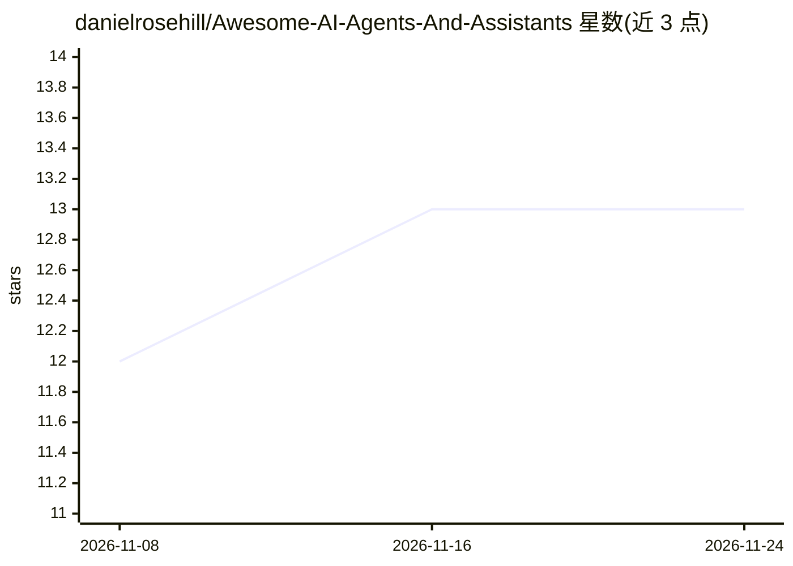

# danielrosehill/Awesome-AI-Agents-And-Assistants

⭐ 13 · JavaScript · 推送 2026-11-03 · [GitHub](https://github.com/danielrosehill/Awesome-AI-Agents-And-Assistants) · [官网](https://blog.danielrosehill.com/posts/curated-ai-indexes-awesome-lists-agents-evals-voice-au87cm/) · 个人维护

**为开发者构建/部署 AI 代理的工具平台策展清单**

由 Daniel Rosehill 维护的 AI 代理平台与工具索引：按开发框架、代理类型、基础设施、部署分发、文档代理、多代理模拟、MCP、前端访问等分类组织，每类指向独立详情页收录相关项目，并附 AI 代理概念说明与教程、论文列表等学习资源。MIT 许可，内容为链接清单形态，2025 年 2 月的生态图谱。

## 筛选速览

| 维度 | 判定 | 备注 |
|---|---|---|
| AI 角色 | `ai-knowledge` | 知识聚合/清单类 |
| 许可风险 | `permissive` | — |
| 部署形态 | `None` |  |
| 模型依赖 | — | README 未给出锁定关系 |
| 硬件要求 | — | 无带数字的原话,不猜 |
| 安装摩擦 | `low` | 无编译、无系统依赖或容器化 |
| 成熟度 | — | 结构信号不足 |

## 能力要点

- 按十余个类别组织的代理平台与工具索引
- 覆盖 MCP、RAG、向量数据库等基础设施条目
- 各分类有独立详情页收录项目

## 适用场景

- 为构建 AI 代理选型开发框架或低代码平台
- 查找特定类型的代理项目（语音/文档/计算机使用等）
- 浏览代理生态的学习资源与论文列表

## 场景标签

`精选清单` · 领域:学习与行业

## 证据(README 行号)

> L5: A curated list of awesome AI agent platforms and tools for building, deploying, and managing AI agents by Daniel Ros
> L15: This repository is organized into logical categories to help you navigate the growing ecosystem of AI agent platfor

## 星数曲线

2026-11-08 12 → 2026-11-24 13（+1）

---
*卡片 v1 · prompt 1.4 · 生成 2026-11-18 · 置信度 high · 依据 README sha `87e219f35bb4` · [字段定义](../../DATASET.md)*
