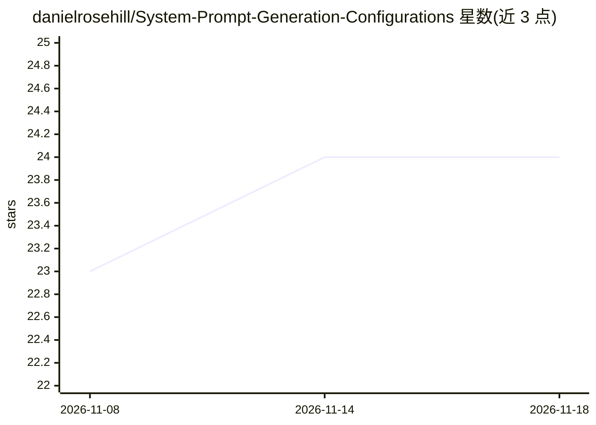

# danielrosehill/System-Prompt-Generation-Configurations

⭐ 24 · Python · 推送 2026-11-03 · [GitHub](https://github.com/danielrosehill/System-Prompt-Generation-Configurations) · [官网](https://blog.danielrosehill.com/posts/ai-prompt-libraries-which-one-to-use-tngfmp/) · 个人维护

**用于生成与改进系统提示词的系统提示词集合（21 个）**

收录 21 个 Markdown 系统提示词文件的仓库，用途是配置能生成、编辑、诊断、改进其他 AI 助手系统提示词的助手。按生成器、编辑器、脱敏、本地化、安全审计等类别组织，另含“分叉”提示词（将现有提示词改造为变体）与一次生成个人版+可开源脱敏版的双联生成配置。使用方式为复制文件内容粘贴到 AI 助手平台的系统提示词字段，无代码与安装步骤。

## 筛选速览

| 维度 | 判定 | 备注 |
|---|---|---|
| AI 角色 | `ai-knowledge` | 知识聚合/清单类 |
| 许可风险 | `none` | — |
| 部署形态 | `None` |  |
| 模型依赖 | — | README 未给出锁定关系 |
| 硬件要求 | — | 无带数字的原话,不猜 |
| 安装摩擦 | `low` | 无编译、无系统依赖或容器化 |
| 成熟度 | — | 结构信号不足 |

## 能力要点

- 21 个面向系统提示词生成/编辑/改进的配置文件
- 覆盖生成器、编辑器、脱敏、本地化、安全审计等类别
- 双联生成：一次产出个人版与可开源的脱敏版
- “分叉”配置：将现有提示词改造为面向另一用途的变体

## 适用场景

- 让 AI 助手帮我起草或改写其他助手的系统提示词
- 把个人化提示词脱敏后准备公开发布
- 对已有系统提示词做诊断与安全审计

## 场景标签

`提示工程` · 领域:Agent 开发

## 证据(README 行号)

> L7: This repository contains a collection of system prompts for creating assistants whose purpose is to:
> L29: > **Note:** These are specialized system prompts specifically designed for generating, editing, and refining other 

## 星数曲线

2026-11-08 23 → 2026-11-18 24（+1）

---
*卡片 v1 · prompt 1.4 · 生成 2026-11-18 · 置信度 high · 依据 README sha `7edb080acdbf` · [字段定义](../../DATASET.md)*
