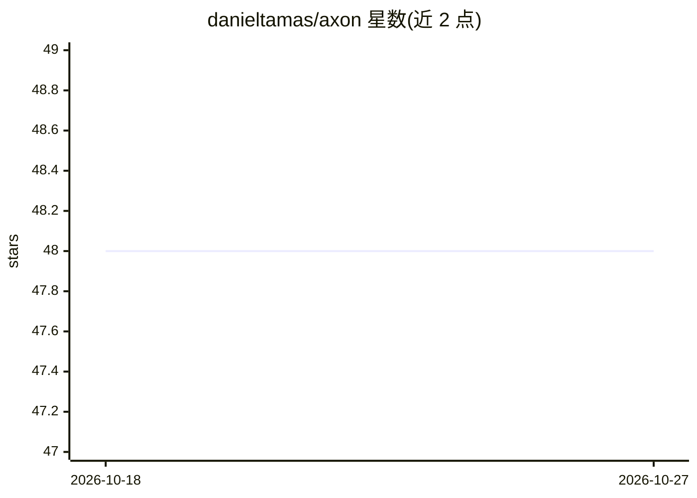

# danieltamas/axon

⭐ 48 · Rust · MIT · 推送 2026-10-25 · [GitHub](https://github.com/danieltamas/axon) · 个人维护

**本机 AI 编码代理的协调总线与观测看板**

单个二进制程序，通过 Claude Code、Codex、OpenCode、Hermes 等代理框架自身的钩子接入，读取其日志并在本地 dashboard（127.0.0.1:7777）展示每个 harness、项目、代理与模型的工作状态、速度、成本与代码产出。代理之间可通过 axon bus 命令互发消息、认领文件或任务，消息落入哈希链审计日志；支持按代理/项目设预算（80% 警告、100% 停止门）。可经端到端加密 QUIC 链路与队友的 Axon 配对共享项目，默认全本地、无遥测，MIT 许可。

## 筛选速览

| 维度 | 判定 | 备注 |
|---|---|---|
| AI 角色 | `ai-ecosystem` | LLM/agent 周边工具 |
| 许可风险 | `permissive` | MIT |
| 部署形态 | `None` |  |
| 模型依赖 | — | README 未给出锁定关系 |
| 硬件要求 | — | 无带数字的原话,不猜 |
| 安装摩擦 | `low` | 无编译、无系统依赖或容器化 |
| 成熟度 | — | 结构信号不足 |

## 能力要点

- 单二进制经 harness 自带钩子接入，自动发现已有会话
- dashboard 展示各代理/模型/仓库的成本与状态，消息可下发停止或结束会话
- axon bus 命令集：代理间问答、文件认领、非文件任务认领、跨厂商代码审查
- 跨机配对共享项目，端到端加密，传输内容不含路径/仓库名/成本

## 适用场景

- 同时跑多个 AI 编码代理时查看各自状态与花费
- 让不同 harness 的代理互相通信、分派任务避免重复工作
- 给团队设预算门槛并审计代理间消息

## 场景标签

`LLM 可观测性` `代码审查` `多智能体` · 领域:Agent 开发

## 证据(README 行号)

> L11: **Axon lets Claude Code, Codex, OpenCode and Hermes see and talk to each other, and shows you
> L30: Run `axon`. It wires itself into the harnesses it finds and opens the dashboard at
> L45:  Every token priced. Cost by model, agent, harness and repository, live. Budgets per agent or tree: a warning at 80

## 星数曲线

2026-10-18 48 → 2026-10-27 48（+0）

---
*卡片 v1 · prompt 1.4 · 生成 2026-10-25 · 置信度 high · 依据 README sha `590e92972070` · [字段定义](../../DATASET.md)*
