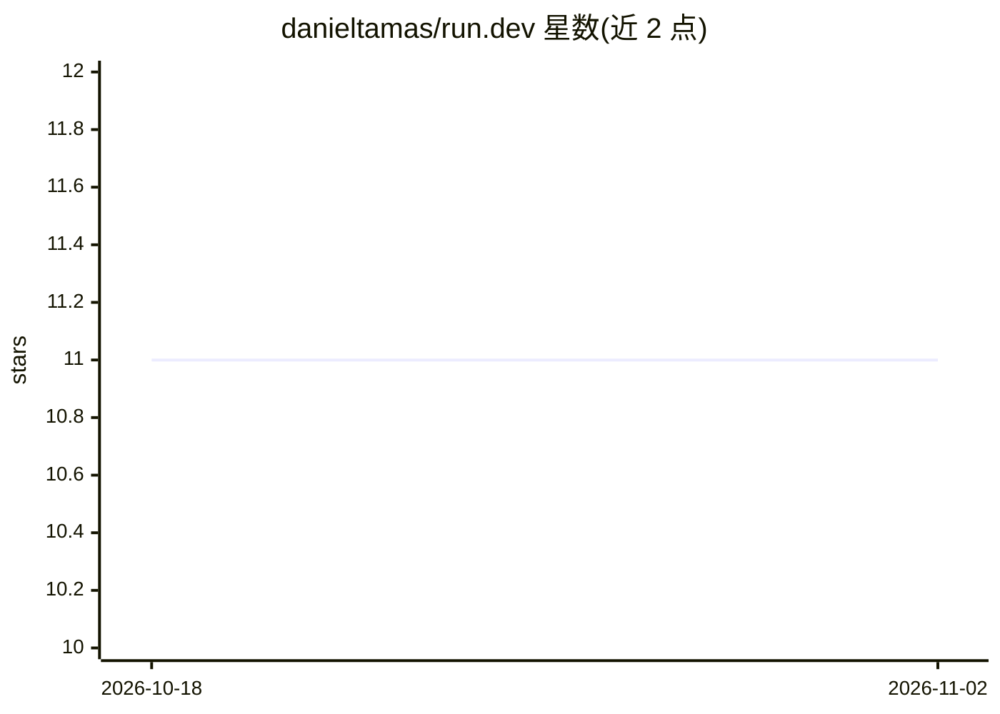

# danieltamas/run.dev

⭐ 11 · Rust · MIT · 推送 2026-10-27 · [GitHub](https://github.com/danieltamas/run.dev) · [官网](https://getrun.dev) · 个人维护

**Rust 单二进制本地开发环境：TUI 管理服务+本地域名HTTPS+AI诊断**

用单个 Rust 二进制替代 MAMP/Nginx 配置/Docker Compose：TUI 仪表盘启动/停止/监控各项目服务，自动生成 .local 域名与 mkcert 受信 HTTPS 证书，SNI 反向代理（支持 WebSocket），自动检测项目类型（npm/cargo/go/rails 等）推断启动命令，崩溃时读取 stderr 分类错误并可一键修复。AI 功能为可选的 Claude Code 集成：发送 stderr 做崩溃诊断、仪表盘内提问、上下文调试，不配置即无 AI 也完整可用。仅支持 macOS/Linux，一行脚本安装或源码编译。

## 筛选速览

| 维度 | 判定 | 备注 |
|---|---|---|
| AI 角色 | `ai-enhanced` | 去掉 AI 部分产品仍成立 |
| 许可风险 | `permissive` | MIT |
| 部署形态 | `self-host` | docker 或自建部署 |
| 模型依赖 | locked-api |  |
| 硬件要求 | — | 无带数字的原话,不猜 |
| 安装摩擦 | `low` | 无编译、无系统依赖或容器化 |
| 成熟度 | — | 结构信号不足 |

## 能力要点

- SNI 反向代理 + 自动 .local 域名 + mkcert 受信 HTTPS（rcgen 回退）
- 自动识别 package.json/Cargo.toml/go.mod/manage.py 等并推断启动命令
- 崩溃错误分类、按 [f] 自动修复（如清除占用端口的进程）
- 可选 Claude Code 集成做崩溃诊断与实时调试，代码日志不出本机

## 适用场景

- 一站式管理多个本地微服务/前端项目并统一以域名访问
- 服务崩溃时快速定位原因并获得修复建议
- 为各项目自动配好本地 HTTPS 证书，免手写 Nginx 配置

## 场景标签

 · 领域:开发者工具/本地开发环境

## 证据(README 行号)

> L192: The AI features are entirely optional. The app works perfectly without them. Disable anytime with `--no-ai` or jus
> L176: Run.dev is built to work with Claude Code, Anthropic's local CLI agent. When a service crashes, run.dev doesn't ju

## 星数曲线

2026-10-18 11 → 2026-11-02 11（+0）

---
*卡片 v1 · prompt 1.4 · 生成 2026-11-02 · 置信度 mid · 依据 README sha `1304b05036ed` · [字段定义](../../DATASET.md)*
