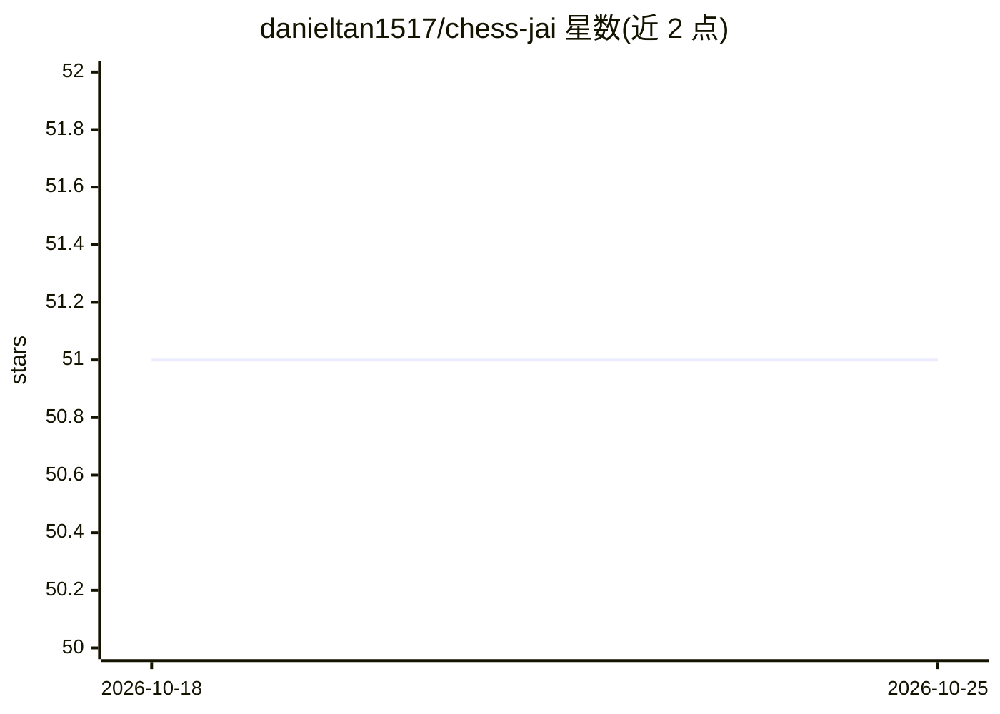

# danieltan1517/chess-jai

⭐ 51 · Jai · 推送 2026-06-19 · [GitHub](https://github.com/danieltan1517/chess-jai) · 个人维护

**Jai 语言编写的国际象棋引擎与图形界面（含 NNUE 评估）**

用 Jai 编程语言编写的国际象棋引擎与配套 GUI，兼作寻找 Jai 编译器 bug 与基准测试的业余项目。引擎实现 UCI 协议，估计 Elo 3100，采用 Negamax/Alpha-Beta 搜索、置换表、多线程惰性 SMP 并行搜索，局面评估基于 NNUE（Stockfish 12 HalfKP 架构）与增量更新，支持 AVX2/SSE/无 SIMD 三种 CPU 路径，可选接入 Daniel Shawul 的 NNUE-Probe C 库。GUI 支持拖拽走子、引擎对弈、多引擎加载、棋钟等。需 Jai 编译器从源码构建，支持 Windows/macOS/Linux。

## 筛选速览

| 维度 | 判定 | 备注 |
|---|---|---|
| AI 角色 | `ai-enhanced` | 去掉 AI 部分产品仍成立 |
| 许可风险 | `none` | — |
| 部署形态 | `None` |  |
| 模型依赖 | — | README 未给出锁定关系 |
| 硬件要求 | — | 无带数字的原话,不猜 |
| 安装摩擦 | `low` | 无编译、无系统依赖或容器化 |
| 成熟度 | `idea` | |

## 能力要点

- UCI 协议引擎，估计 Elo 3100，多线程并行搜索
- NNUE（Stockfish 12 HalfKP）评估，支持 AVX2/SSE/CPU 无 SIMD 路径
- GUI 支持人机/机机对弈、多引擎加载、FEN 载入、盲棋模式
- 移动生成速度 324M positions/秒，Magic Bitboards 与 Kogge-Stone 算法

## 适用场景

- 在图形界面中与自研引擎或 Stockfish 等 UCI 引擎对弈
- 作为 UCI 引擎接入其他国际象棋 GUI 进行对局
- 在非主流 SIMD 架构上通过 NNUE-Probe C 库运行 NNUE 评估

## 场景标签

 · 领域:游戏/棋类引擎

## 证据(README 行号)

> L3: This Chess Engine in Jai is a hobby project designed to find bugs and benchmark the Jai Compiler.
> L7: This project includes both a Chess Graphical User Interface and a UCI compatible Chess Engine.
> L137: * Efficiently Updatable Neural Networks with Incremental Update
> L139: * NNUE Stockfish 12 HalfKP Architecture

## 星数曲线

2026-10-18 51 → 2026-10-25 51（+0）

---
*卡片 v1 · prompt 1.4 · 生成 2026-10-24 · 置信度 high · 依据 README sha `de4c09425487` · [字段定义](../../DATASET.md)*
