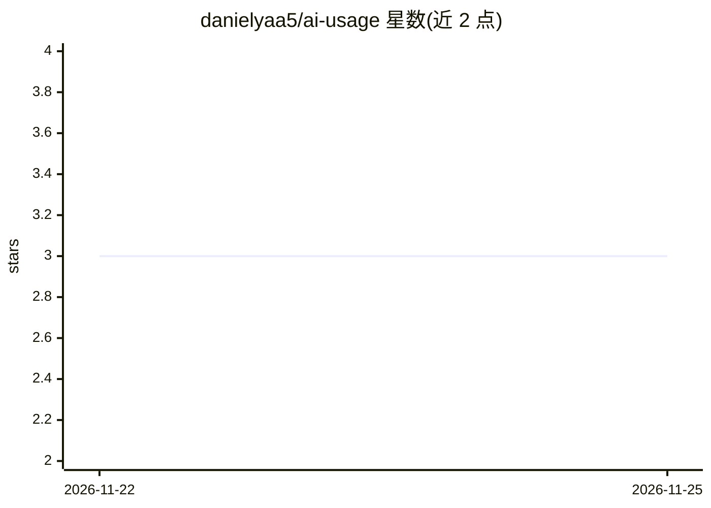

# danielyaa5/ai-usage

⭐ 3 · Swift · MIT · 推送 2026-11-23 · [GitHub](https://github.com/danielyaa5/ai-usage) · [官网](https://danielyakobian.com/ai-usage/) · 个人维护

**macOS 本地面板：统计 Claude Code/Codex/Antigravity 用量与套餐额度**

读取本机 Claude Code、Codex、Antigravity 的本地日志与端点（~/.claude、~/.codex、~/.gemini 下的 jsonl/rollout/db 文件，及 127.0.0.1:4318 遥测），汇总套餐限额余量、按 API 牌价折算的等效费用、按任务/应用/模型/推理档位的用量分布。以 Python 面板形式运行（LaunchAgent 常驻 8796 端口），另有独立 Mac 应用与桌面小组件；无第三方包依赖，日志只读且不存提示文本。所读接口非官方 API，工具更新可能失效。

## 筛选速览

| 维度 | 判定 | 备注 |
|---|---|---|
| AI 角色 | `ai-ecosystem` | LLM/agent 周边工具 |
| 许可风险 | `permissive` | MIT |
| 部署形态 | `None` |  |
| 模型依赖 | — | README 未给出锁定关系 |
| 硬件要求 | — | 无带数字的原话,不猜 |
| 安装摩擦 | `low` | 无编译、无系统依赖或容器化 |
| 成熟度 | — | 结构信号不足 |

## 能力要点

- 读取本地 jsonl/rollout/db 日志与 loopback 遥测端点，每分钟增量解析
- 按套餐限额窗口（5 小时/周）显示剩余额度与等效 API 价值
- 按任务规则（遥测属性/首条提示/工作目录）归属用量
- 提供 /api/widget JSON 端点与 macOS 桌面小组件

## 适用场景

- 在固定费率订阅下查看套餐额度还剩多少
- 估算同样的请求走 API 计费要花多少钱
- 按项目或后台任务统计各模型的 token 消耗

## 场景标签

`LLM 可观测性` · 领域:评测与运维

## 证据(README 行号)

> L3: A local dashboard for the Claude Code, Codex (ChatGPT) and Antigravity (Gemini) usage on your Mac:
> L38: None of these are official usage APIs. They are the files and local endpoints the tools use
> L56: macOS and Python 3.9 or later; no packages are needed. Install the CLIs you want measured

## 星数曲线

2026-11-22 3 → 2026-11-25 3（+0）

---
*卡片 v1 · prompt 1.4 · 生成 2026-11-22 · 置信度 high · 依据 README sha `92306afd4896` · [字段定义](../../DATASET.md)*
