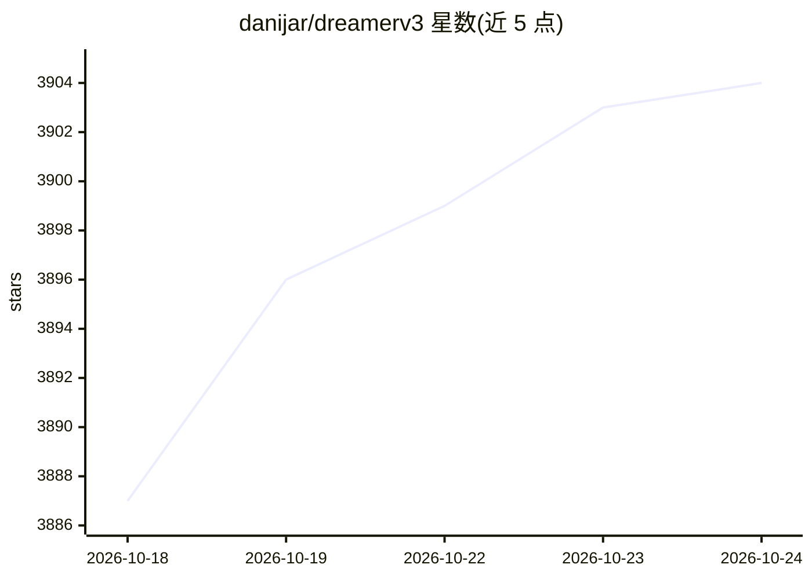

# danijar/dreamerv3

⭐ 3,905 · Python · MIT · 推送 2026-10-04 · [GitHub](https://github.com/danijar/dreamerv3) · [官网](https://danijar.com/dreamerv3) · 个人维护

**DreamerV3 强化学习算法的 JAX 复现实现，供研究训练**

Danijar Hafner 等人论文 DreamerV3 的开源复现：从经验中学习世界模型，将感官输入编码为离散表征并预测未来表征与奖励，再从想象轨迹训练 actor-critic 策略。以固定超参数适配 Atari、Crafter 等多类任务。提供训练脚本、Dockerfile 与结果查看工具（Scope，另支持 WandB/TensorBoard 输出），默认尝试 GPU 运行，可切换 CPU/TPU。需 Python 3.11+ 与 JAX，在 Linux/Mac 测试。

## 筛选速览

| 维度 | 判定 | 备注 |
|---|---|---|
| AI 角色 | `ai-native` | 本体是模型或模型工具 |
| 许可风险 | `permissive` | MIT |
| 部署形态 | `self-host` | docker 或自建部署 |
| 模型依赖 | — | README 未给出锁定关系 |
| 硬件要求 | — | 无带数字的原话,不猜 |
| 安装摩擦 | `low` | 无编译、无系统依赖或容器化 |
| 成熟度 | — | 结构信号不足 |

## 能力要点

- 世界模型学习 + 想象轨迹训练 actor-critic 的完整实现
- 固定超参数适配多领域任务（Atari、Crafter 等配置）
- 提供 Dockerfile 与手动安装两种途径
- 支持 GPU/CPU/TPU 切换与断点续训

## 适用场景

- 复现论文结果或在自定义任务上训练 DreamerV3
- 研究世界模型与数据效率的缩放行为
- 作为强化学习算法的基线实现进行实验

## 场景标签

`强化学习` · 领域:训练与推理

## 证据(README 行号)

> L3: A reimplementation of [DreamerV3][paper], a scalable and general reinforcement
> L26: DreamerV3 learns a world model from experiences and uses it to train an actor

## 星数曲线

2026-10-18 3,887 → 2026-10-24 3,904（+17）

---
*卡片 v1 · prompt 1.4 · 生成 2026-10-20 · 置信度 high · 依据 README sha `43238cb8c328` · [字段定义](../../DATASET.md)*
