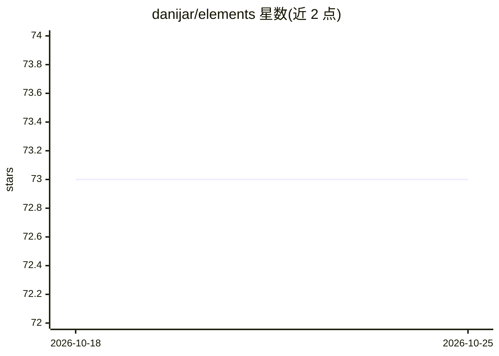

# danijar/elements

⭐ 73 · Python · MIT · 推送 2026-10-04 · [GitHub](https://github.com/danijar/elements) · [官网](https://danijar.com) · 个人维护

**面向科研代码的通用构件库：日志/配置/检查点等**

Python 工具库，为科研代码提供一组通用构件：可扩展多后端的数组 Logger（Terminal/JSONL/TensorBoard/WandB/MLFlow，后台线程写入）、不可变嵌套配置 Config、命令行标志解析 Flags、支持本地与 GCS 的文件系统抽象 Path、后台线程写入的 Checkpoint、程序计时统计 Timer、按步数/时间触发代码的 when 助手，以及基于 gzipped JSON 的 plotting 工具。代码设计为可 fork 单文件修改。面向科研与机器学习实验代码的开发者，pip 安装。

## 筛选速览

| 维度 | 判定 | 备注 |
|---|---|---|
| AI 角色 | `ai-ecosystem` | LLM/agent 周边工具 |
| 许可风险 | `permissive` | MIT |
| 部署形态 | `library` | 以包/库形式分发 |
| 模型依赖 | — | README 未给出锁定关系 |
| 硬件要求 | — | 无带数字的原话,不猜 |
| 安装摩擦 | `low` | 无编译、无系统依赖或容器化 |
| 成熟度 | — | 结构信号不足 |

## 能力要点

- 多后端 Logger（TensorBoard/WandB/MLFlow/JSONL/终端），后台线程写入不阻塞
- 不可变嵌套 Config 与类型检查的 Flags 解析器
- 支持 GCS 桶的可扩展 Path 抽象与原子性 Checkpoint
- Timer、when 触发器与 run 格式绘图工具

## 适用场景

- 为 ML 实验代码提供日志、配置与检查点等基础设施
- 在云存储（GCS）环境下记录训练指标与保存检查点
- 快速搭建科研脚本并绘制多 run 对比图

## 场景标签

`科研工具` `MLOps` · 领域:学习与行业

## 证据(README 行号)

> L5: Building blocks for productive research.
> L22: A logger for array types that is extensible through backends. Metrics are
> L31: - `TensorBoardOutput(logdir)`: Scalars, histograms, images, GIFs.

## 星数曲线

2026-10-18 73 → 2026-10-25 73（+0）

---
*卡片 v1 · prompt 1.4 · 生成 2026-10-24 · 置信度 mid · 依据 README sha `efe6fea7958b` · [字段定义](../../DATASET.md)*
