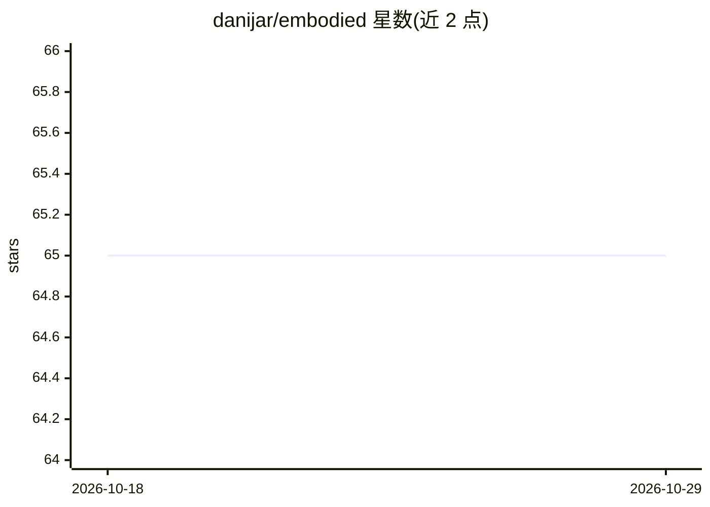

# danijar/embodied

⭐ 65 · Python · MIT · 推送 2026-05-25 · [GitHub](https://github.com/danijar/embodied) · [官网](https://embodied.readthedocs.org) · 个人维护

**面向科研的快速强化学习研究框架**

强化学习研究代码库，为环境与智能体分别定义统一接口，用户可自由组合智能体、环境套件（Gym、Atari、DMC、Crafter）与评测协议。提供配置、日志、检查点、仿真等通用组件，鼓励用户 fork 获取更多控制权。唯一依赖为 Numpy，智能体可用任意框架实现。以 Python 包形式通过 PyPI 提供。

## 筛选速览

| 维度 | 判定 | 备注 |
|---|---|---|
| AI 角色 | `ai-native` | 本体是模型或模型工具 |
| 许可风险 | `permissive` | MIT |
| 部署形态 | `library` | 以包/库形式分发 |
| 模型依赖 | — | README 未给出锁定关系 |
| 硬件要求 | — | 无带数字的原话,不猜 |
| 安装摩擦 | `low` | 无编译、无系统依赖或容器化 |
| 成熟度 | — | 结构信号不足 |

## 能力要点

- 环境与智能体统一接口，可混搭组合
- 内置 Gym/Atari/DMC/Crafter 等环境套件与评测协议
- 唯一依赖 Numpy，智能体实现不限定框架
- core 包含配置、日志、检查点、仿真与包装器组件

## 适用场景

- 研究者快速实现和评测新的强化学习智能体
- 在不同环境套件间复用同一智能体实现
- 以 fork 方式定制实验流程与评测协议

## 场景标签

`强化学习` `科研工具` · 领域:学习与行业

## 证据(README 行号)

> L5: Fast reinforcement learning research.
> L13: encouraged to fork when more control is needed. The only dependency is Numpy

## 星数曲线

2026-10-18 65 → 2026-10-29 65（+0）

---
*卡片 v1 · prompt 1.4 · 生成 2026-10-24 · 置信度 high · 依据 README sha `08337e8cc50a` · [字段定义](../../DATASET.md)*
