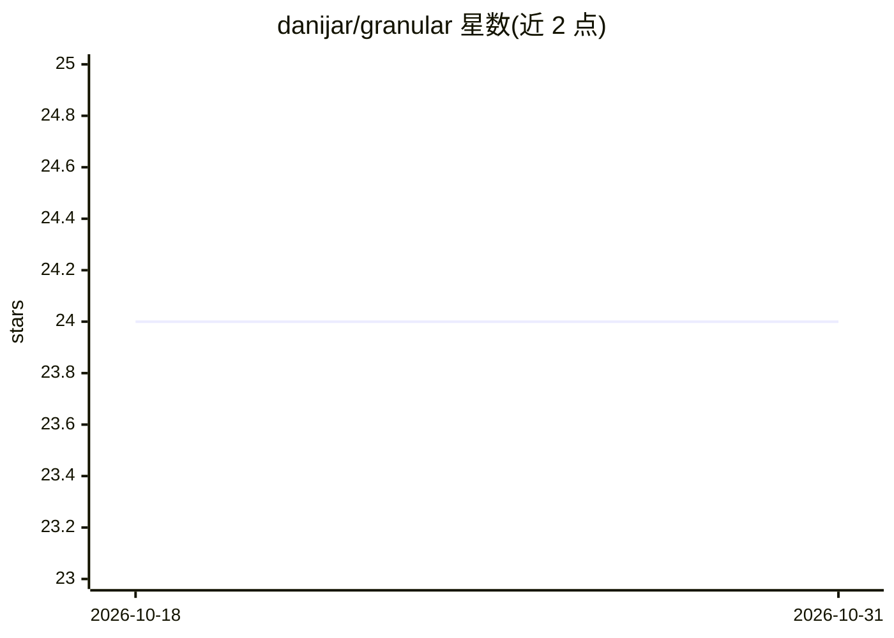

# danijar/granular

⭐ 24 · Python · MIT · 推送 2026-10-15 · [GitHub](https://github.com/danijar/granular) · [官网](https://pypi.org/project/granular) · 个人维护

**面向机器学习的数据集格式与高性能数据加载器**

Python 数据集存储格式：每个数据集由可寻址的记录文件（.bag+.idx）组成，支持按索引快速随机读取、可断点续写的追加，及分片存储以并行化处理。附带确定性的数据加载器，可按 step+seed 断点恢复，支持列子集读取、内存缓存小值与索引表、自定义编码/解码器（示例支持 Numpy 数组、图像、视频等）。自定义 Path 实现可接入 GCS 等云存储。0.22.0 更改了文件格式，旧数据仍可读。面向机器学习训练数据处理场景。

## 筛选速览

| 维度 | 判定 | 备注 |
|---|---|---|
| AI 角色 | `ai-ecosystem` | LLM/agent 周边工具 |
| 许可风险 | `permissive` | MIT |
| 部署形态 | `library` | 以包/库形式分发 |
| 模型依赖 | — | README 未给出锁定关系 |
| 硬件要求 | — | 无带数字的原话,不猜 |
| 安装摩擦 | `low` | 无编译、无系统依赖或容器化 |
| 成熟度 | — | 结构信号不足 |

## 能力要点

- 可寻址记录文件支持快速随机访问与可续写追加
- 确定性且可断点恢复的数据加载器（step+seed）
- 分片存储与 shardstart/shardstep 并行处理
- 列子集读取与索引/小值内存缓存

## 适用场景

- 为机器学习训练管道存储与加载大规模数据集
- 多进程/多机并行处理分片数据集
- 在云存储（如 GCS）上直接读写训练数据

## 场景标签

 · 领域:机器学习基础设施

## 证据(README 行号)

> L5: Granular is simple and scalable dataset format. Each dataset is a collection
> L7: appends. Granular comes with a high-performance data loader.

## 星数曲线

2026-10-18 24 → 2026-10-31 24（+0）

---
*卡片 v1 · prompt 1.4 · 生成 2026-10-27 · 置信度 high · 依据 README sha `81918c3d6a5f` · [字段定义](../../DATASET.md)*
