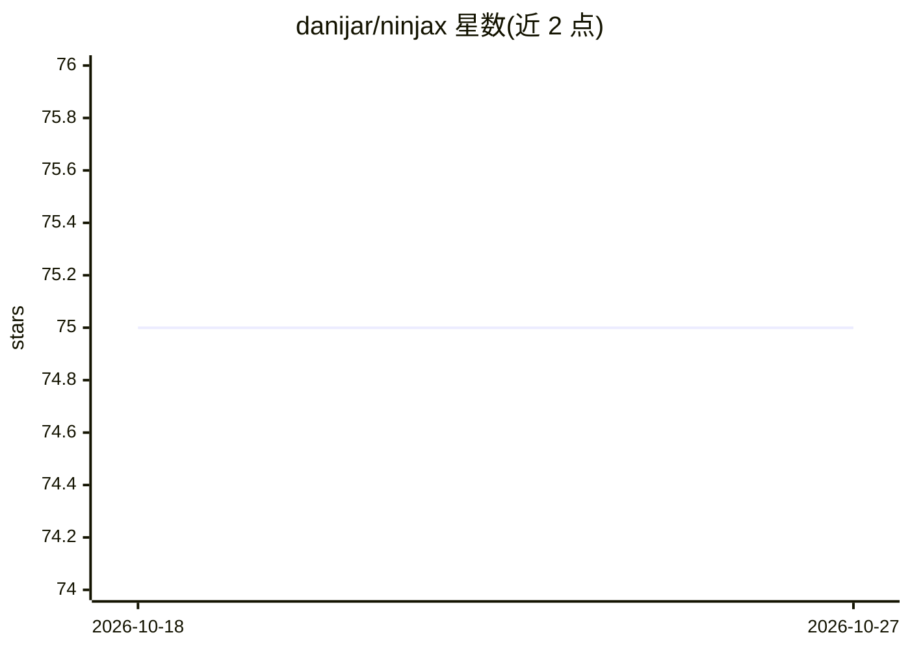

# danijar/ninjax

⭐ 75 · Python · MIT · 推送 2026-04-07 · [GitHub](https://github.com/danijar/ninjax) · [官网](https://ninjax.readthedocs.io) · 个人维护

**给 JAX 开发者的通用模块系统库：透明管理模块状态**

面向 JAX 用户的通用模块系统，提供 nj.Module 基类。模块可存储模型参数、Adam 动量缓冲、BatchNorm 统计量、循环状态等，任意方法可初始化/读取/写入状态条目，无需 Flax 的 build() 或 @compact 机制。状态以扁平 dict（字符串键映射到 jnp.array）而非 PyTree 组织，便于遍历、修改与保存加载；支持混用 Flax、Haiku 等不同库的模块。库为单文件，可直接复制到项目或 pip 安装。限制：需在 JAX 生态内使用。

## 筛选速览

| 维度 | 判定 | 备注 |
|---|---|---|
| AI 角色 | `ai-ecosystem` | LLM/agent 周边工具 |
| 许可风险 | `permissive` | MIT |
| 部署形态 | `library` | 以包/库形式分发 |
| 模型依赖 | — | README 未给出锁定关系 |
| 硬件要求 | — | 无带数字的原话,不猜 |
| 安装摩擦 | `low` | 无编译、无系统依赖或容器化 |
| 成熟度 | — | 结构信号不足 |

## 能力要点

- 任意方法可初始化/读取/写入状态条目，模块可内置 train 方法
- 状态为扁平 dict（如 /net/layer1/weights → jnp.array），非 PyTree
- 可混用 Flax、Haiku 等不同库的模块
- 单文件库，可直接复制到项目使用

## 适用场景

- 在 JAX 项目中自管理模型参数与优化器状态
- 混用 Flax/Haiku 等不同库的模块构建网络
- 需要模块内部自更新参数（如 train 方法）的训练流程

## 场景标签

 · 领域:深度学习框架组件

## 证据(README 行号)

> L5: Ninjax is a general and practical module system for [JAX][jax]. It gives users
> L11: Ninjax provides a simple and general `nj.Module` class.

## 星数曲线

2026-10-18 75 → 2026-10-27 75（+0）

---
*卡片 v1 · prompt 1.4 · 生成 2026-10-24 · 置信度 high · 依据 README sha `88d68a626351` · [字段定义](../../DATASET.md)*
