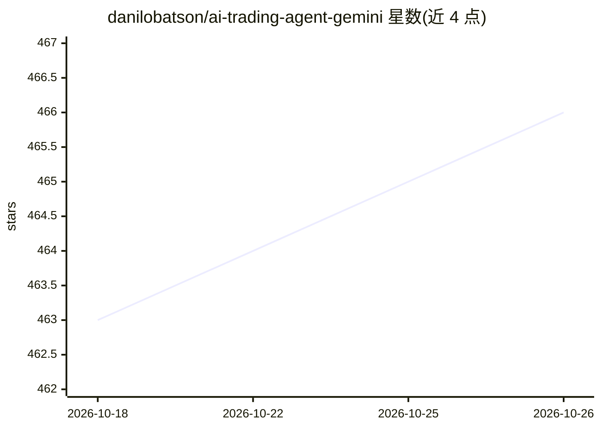

# danilobatson/ai-trading-agent-gemini

⭐ 466 · TypeScript · 推送 2026-01-05 · [GitHub](https://github.com/danilobatson/ai-trading-agent-gemini) · [官网](https://ai-trading-agent-gemini.vercel.app/) · 个人维护

**将社交媒体情绪转为加密货币交易信号的 AI Agent 应用**

基于 Next.js 15 + TypeScript 的全栈 Web 应用：读取 LunarCrush 的加密货币社交媒体指标（提及量、互动、AltRank™、Galaxy Score™），经 Google Gemini 生成带置信度的 BUY/SELL/HOLD 交易信号，Inngest 承载 7 步后台分析工作流，Supabase 提供实时进度与信号存储，可选 Discord 通知。运行需 4 个 API key（LunarCrush 为付费订阅），本地双终端启动开发服务器，支持 Vercel/Netlify/Railway 部署。

## 筛选速览

| 维度 | 判定 | 备注 |
|---|---|---|
| AI 角色 | `ai-native` | 本体是模型或模型工具 |
| 许可风险 | `none` | — |
| 部署形态 | `library` | 以包/库形式分发 |
| 模型依赖 | — | README 未给出锁定关系 |
| 硬件要求 | — | 无带数字的原话,不猜 |
| 安装摩擦 | `low` | 无编译、无系统依赖或容器化 |
| 成熟度 | — | 结构信号不足 |

## 能力要点

- LunarCrush 社交指标 + Gemini 生成带置信度的交易信号
- Inngest 7 步后台工作流，实时进度追踪
- Supabase 实时订阅驱动仪表盘更新
- 可选 Discord 告警与 Vercel 一键部署

## 适用场景

- 我在加密货币交易前参考社交情绪与 AI 信号
- 我想观察 AI 分析管道的分步执行过程
- 作为全栈 AI 应用的开发参考模板

## 场景标签

`金融量化` `数据分析` · 领域:效率与自动化

## 证据(README 行号)

> L15: This AI Trading Agent analyzes **real-time social media sentiment** from LunarCrush's API and generates **intellige
> L22: - 🧠 **AI-Powered Signals** - Google Gemini generates BUY/SELL/HOLD recommendations with confidence scores

## 星数曲线

2026-10-18 463 → 2026-10-26 466（+3）

---
*卡片 v1 · prompt 1.4 · 生成 2026-10-21 · 置信度 mid · 依据 README sha `a86841c7c0eb` · [字段定义](../../DATASET.md)*
