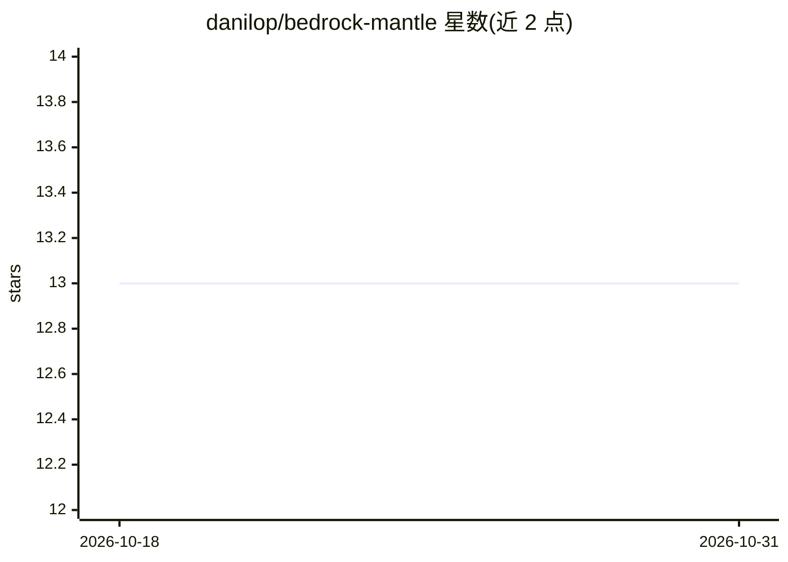

# danilop/bedrock-mantle

⭐ 13 · Python · MIT · 推送 2025-12-16 · [GitHub](https://github.com/danilop/bedrock-mantle) · 个人维护

**探索 Amazon Bedrock OpenAI 兼容 API 的 CLI 工具**

面向使用 Amazon Bedrock Project Mantle 的开发者的命令行探索工具：通过交互式 chat 命令测试两种 OpenAI 兼容 API——默认的 Responses API（服务端有状态会话、后台异步处理）与 Chat Completions API（客户端管理上下文、支持全部 Bedrock 模型、ZDR 合规）。支持流式输出、列出可用模型、查询 API 信息，通过 OPENAI_BASE_URL 与 OPENAI_API_KEY 环境变量配置，以 uv tool 安装，MIT 许可。

## 筛选速览

| 维度 | 判定 | 备注 |
|---|---|---|
| AI 角色 | `ai-ecosystem` | LLM/agent 周边工具 |
| 许可风险 | `permissive` | MIT |
| 部署形态 | `None` |  |
| 模型依赖 | locked-api |  |
| 硬件要求 | — | 无带数字的原话,不猜 |
| 安装摩擦 | `low` | 无编译、无系统依赖或容器化 |
| 成熟度 | — | 结构信号不足 |

## 能力要点

- 交互式聊天测试 Responses API 与 Chat Completions API
- Responses API 支持服务端会话状态与后台异步处理
- Chat Completions API 支持全部 Bedrock 模型与 ZDR 合规
- list-models 列出区域内可用模型

## 适用场景

- 我在接入 Bedrock OpenAI 兼容 API 前先测试端点行为
- 比较有状态 Responses API 与无状态 Completions API 的差异
- 查询所在区域 Bedrock 可用模型列表

## 场景标签

 · 领域:LLM 基础设施/云服务工具

## 证据(README 行号)

> L3: A CLI for exploring Amazon Bedrock OpenAI-compatible APIs.
> L11: This CLI is an **exploration tool** to help you understand and test these new endpoints.

## 星数曲线

2026-10-18 13 → 2026-10-31 13（+0）

---
*卡片 v1 · prompt 1.4 · 生成 2026-10-31 · 置信度 high · 依据 README sha `3c14df3982fd` · [字段定义](../../DATASET.md)*
