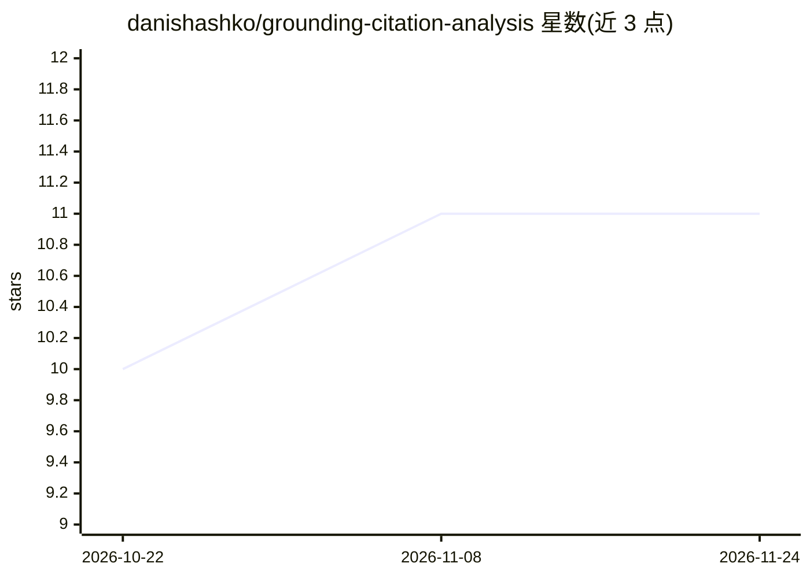

# danishashko/grounding-citation-analysis

⭐ 11 · Python · MIT · 推送 2026-09-04 · [GitHub](https://github.com/danishashko/grounding-citation-analysis) · 个人维护

**解析 Google AI Mode 引用句级数据的开源研究流水线**

复现性研究仓库，通过解码 Google AI Mode 与 Gemini 引用 URL 中的 `#:~:text=` 文本片段，在句级分析 42,971 条 AI 引用：经 Bright Data 抓取器收集 100 个查询的真实 SERP 引用，解码被引句并定位其在源页面中的相对位置，再做统计检验（t 检验、卡方、ANOVA）与图表可视化。需要 Python 3.11+、Bright Data API key 及约 $6–25 数据采集预算。数据集已迁至合并仓库，本仓库保留完整流水线、notebook 与图表。

## 筛选速览

| 维度 | 判定 | 备注 |
|---|---|---|
| AI 角色 | `ai-knowledge` | 知识聚合/清单类 |
| 许可风险 | `permissive` | MIT |
| 部署形态 | `None` |  |
| 模型依赖 | — | README 未给出锁定关系 |
| 硬件要求 | — | 无带数字的原话,不猜 |
| 安装摩擦 | `low` | 无编译、无系统依赖或容器化 |
| 成熟度 | — | 结构信号不足 |

## 能力要点

- 解码 #:~:text= 片段获得 Google 精确引用的原句
- 句级位置分析与统计检验（t 检验/卡方/ANOVA）
- 提供完整可复现的收集-解析-抓取-分析-可视化流水线
- citations.csv 与 source_pages.csv 的结构化数据 schema

## 适用场景

- 研究 AI 搜索引用偏好的内容优化者
- 复现句级引用位置偏倚统计检验
- SEO 从业者分析结构化内容对被引概率的影响

## 场景标签

`科研工具` · 领域:学习与行业

## 证据(README 行号)

> L5: **Reverse engineering Google AI Mode's sentence-level citation behaviour using `#:~:text=` URL fragments.**
> L29: 1. **Collect** — Use Bright Data's Google AI Mode Scraper (real SERP, not API) to gather citation URLs for 100 quer

## 星数曲线

2026-10-22 10 → 2026-11-24 11（+1）

---
*卡片 v1 · prompt 1.4 · 生成 2026-11-18 · 置信度 high · 依据 README sha `022ce5c930e8` · [字段定义](../../DATASET.md)*
