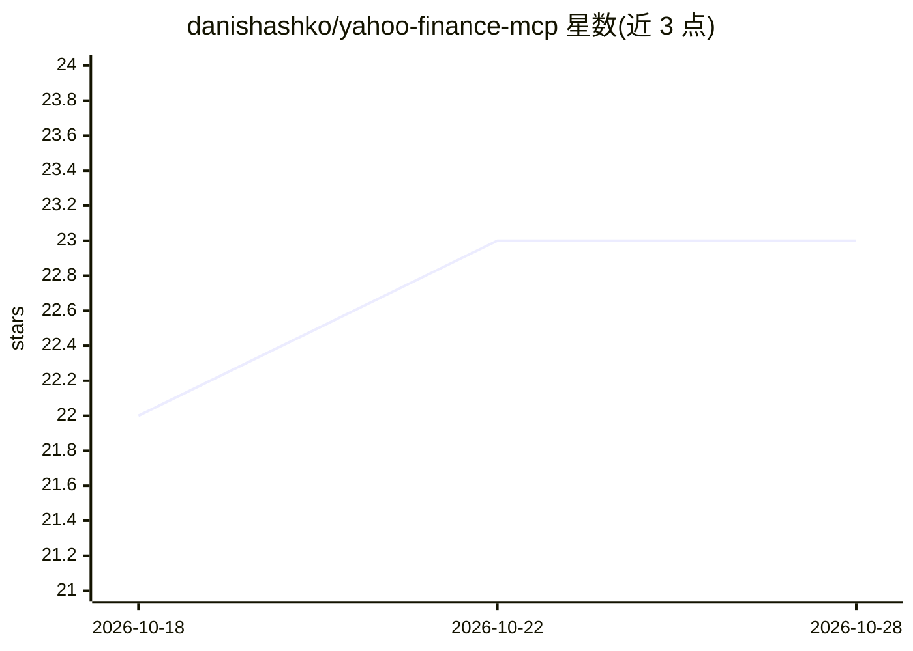

# danishashko/yahoo-finance-mcp

⭐ 23 · Python · MIT · 推送 2026-09-04 · [GitHub](https://github.com/danishashko/yahoo-finance-mcp) · [官网](https://www.linkedin.com/in/daniel-shashko/) · 个人维护

**给 Claude 等 MCP 客户端提供 Yahoo Finance 股票数据的服务器**

基于 Model Context Protocol 的 Yahoo Finance 数据服务器，供 Claude Desktop 及任意 MCP 兼容客户端（含 n8n 等 HTTP 客户端）接入。提供 13 个工具：实时报价、历史 OHLCV、公司概况、三大财务报表、分析师评级与预测、期权链、持股数据、股息拆分、代码搜索与市场状态。通过 yfinance 库读取免费 Yahoo Finance API，输出默认 markdown 或 JSON。需 Python 3.10+ 与 Node.js 16+，支持 npx 一键启动、npm 全局安装或直接运行 Python 脚本；HTTP 模式无鉴权，限个人教育研究用途，Yahoo 限流约 2000 次/小时/IP。

## 筛选速览

| 维度 | 判定 | 备注 |
|---|---|---|
| AI 角色 | `ai-ecosystem` | LLM/agent 周边工具 |
| 许可风险 | `permissive` | MIT |
| 部署形态 | `library` | 以包/库形式分发 |
| 模型依赖 | locked-api |  |
| 硬件要求 | — | 无带数字的原话,不猜 |
| 安装摩擦 | `low` | 无编译、无系统依赖或容器化 |
| 成熟度 | — | 结构信号不足 |

## 能力要点

- 13 个工具覆盖报价/财报/评级/期权链/持股等 Yahoo Finance 数据
- stdio 与 Streamable HTTP（--http）双模式，适配 n8n 等仅接 URL 的客户端
- npx 首次运行自动创建隔离 Python 环境并安装依赖
- 共享单个浏览器模拟 HTTP 会话以缓解 Yahoo 限流

## 适用场景

- 在 Claude Desktop 里用自然语言查询股票行情与财报
- 通过 n8n MCP Client 节点把行情数据接入自动化流程
- 并排比较多家公司的关键指标

## 场景标签

 · 领域:金融数据/MCP 工具

## 证据(README 行号)

> L8: Real-time stock market data for Claude Desktop and any MCP-compatible client, powered by Yahoo Finance. Get quotes, 
> L66: `--http` serves the same 13 tools over Streamable HTTP at `/mcp`:
> L167: This server never talks to a model. Your client starts it as a local process and

## 星数曲线

2026-10-18 22 → 2026-10-28 23（+1）

---
*卡片 v1 · prompt 1.4 · 生成 2026-10-27 · 置信度 mid · 依据 README sha `7d19694132e6` · [字段定义](../../DATASET.md)*
