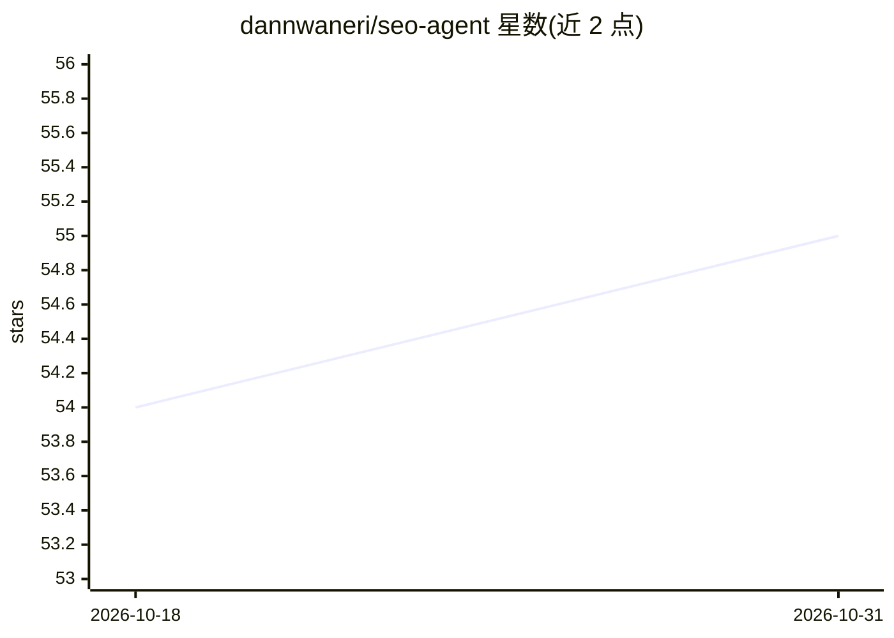

# dannwaneri/seo-agent

⭐ 55 · Python · MIT · 推送 2026-09-03 · [GitHub](https://github.com/dannwaneri/seo-agent) · 个人维护

**本地 SEO 审计 agent：真实浏览器巡检与多引擎 AI 引用追踪**

基于 Python、Browser Use（Playwright 驱动的真实 Chromium）与 Claude API 的本地 SEO 工具：访问 URL 提取 title/description/H1/canonical，异步检查同域死链，按 PASS/FAIL 规则输出 report.json 与纯文本摘要，支持中断续跑与多项目隔离。另含独立模块：外链质量评分、GSC 快速机会分析、内链相关性评分、主题聚类审计、SearchApi SERP 特征检测，以及跨 Claude/ChatGPT/Gemini/Perplexity/Copilot 五引擎的域名引用可见性检测。需自备 ANTHROPIC_API_KEY 与 SEARCHAPI_KEY，默认路由 Claude Sonnet，--tiered 可先走低成本检查。

## 筛选速览

| 维度 | 判定 | 备注 |
|---|---|---|
| AI 角色 | `ai-native` | 本体是模型或模型工具 |
| 许可风险 | `permissive` | MIT |
| 部署形态 | `library` | 以包/库形式分发 |
| 模型依赖 | locked-api |  |
| 硬件要求 | — | 无带数字的原话,不猜 |
| 安装摩擦 | `low` | 无编译、无系统依赖或容器化 |
| 成熟度 | — | 结构信号不足 |

## 能力要点

- 真实 Chromium 浏览器访问页面，非 headless 抓取，边缘场景可暂停人工介入
- 五引擎 LLM 可见性检测：检查域名是否被 Claude/ChatGPT/Gemini/Perplexity/Copilot 引用
- 外链评分（利基相关性 50%/流量质量 30%/垃圾信号 20%）与内链相关性评分
- 状态写入扁平 JSON，中断后可从断点续跑

## 适用场景

- 对自己的站点做 SEO 巡检，找出死链、缺失 canonical、孤儿页等问题
- 检查域名在 ChatGPT、Perplexity 等 AI 引擎回答中的被引用情况
- 分析 Search Console 导出数据，定位快速优化机会与关键词蚕食
- 评分外链来源域名与候选内链页面的价值

## 场景标签

`浏览器自动化` · 领域:效率与自动化

## 证据(README 行号)

> L3: A local SEO co-pilot built with Python, Browser Use, and the Claude API. Visits real pages in a visible browser wind
> L36: - Anthropic Claude API — structured SEO signal extraction (Haiku for modules, Sonnet for core)

## 星数曲线

2026-10-18 54 → 2026-10-31 55（+1）

---
*卡片 v1 · prompt 1.4 · 生成 2026-10-24 · 置信度 mid · 依据 README sha `f1440f5a33d8` · [字段定义](../../DATASET.md)*
