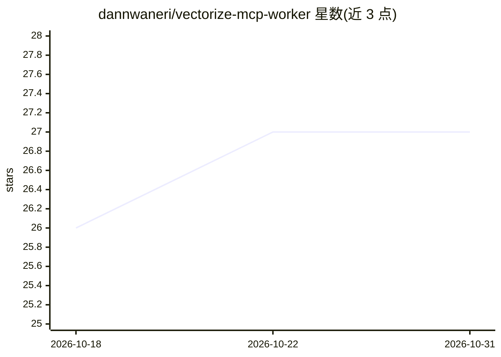

# dannwaneri/vectorize-mcp-worker

⭐ 27 · TypeScript · MIT · 推送 2026-05-18 · [GitHub](https://github.com/dannwaneri/vectorize-mcp-worker) · [官网](https://vectorize-mcp-worker.fpl-test.workers.dev/dashboard ) · 个人维护

**部署在 Cloudflare Workers 上的混合检索 RAG 服务与 MCP 服务器**

用 TypeScript 编写、整体运行于 Cloudflare Workers 的 RAG 基础设施：向量 + BM25 混合检索（RRF 融合）、cross-encoder 重排、元数据过滤、查询智能路由（SQL/BM25/向量三级），以及每次入库后用 LLM 生成并索引知识反思摘要的机制。提供原生 MCP 服务器（Streamable HTTP，六个工具），可接入 Claude Desktop、Cursor 等客户端。支持图像摄取（视觉 + OCR）、多租户隔离、两层缓存与限流。安装需 Cloudflare 账号、Node.js v18+ 与 Wrangler CLI，克隆仓库并配置 Vectorize 索引与 D1 数据库后部署。

## 筛选速览

| 维度 | 判定 | 备注 |
|---|---|---|
| AI 角色 | `ai-ecosystem` | LLM/agent 周边工具 |
| 许可风险 | `permissive` | MIT |
| 部署形态 | `library` | 以包/库形式分发 |
| 模型依赖 | — | README 未给出锁定关系 |
| 硬件要求 | — | 无带数字的原话,不猜 |
| 安装摩擦 | `low` | 无编译、无系统依赖或容器化 |
| 成熟度 | — | 结构信号不足 |

## 能力要点

- 向量 + BM25 混合检索，RRF 融合与 cross-encoder 重排
- 原生 MCP 服务器（Streamable HTTP），六个工具，Durable Objects 会话隔离
- 知识反思层：入库后 LLM 合成三句洞察并以 1.5x 排名加权
- 三级查询路由（实体走 SQL、关键词走 BM25、语义走向量管线）

## 适用场景

- 把内部文档、Notion/Confluence 导出做成团队知识库并通过 Claude Desktop 检索
- SaaS 多租户场景下为每个客户提供隔离的文档搜索
- 票据/收据图片摄取与视觉相似图片检索

## 场景标签

`RAG` · 领域:知识与检索

## 证据(README 行号)

> L37: **Native MCP Server** — Streamable HTTP at `/mcp`, backed by Cloudflare Durable Objects per session. Six tools: `se
> L209: |Component|What's used|

## 星数曲线

2026-10-18 26 → 2026-10-31 27（+1）

---
*卡片 v1 · prompt 1.4 · 生成 2026-10-26 · 置信度 high · 依据 README sha `4d25981bb34f` · [字段定义](../../DATASET.md)*
