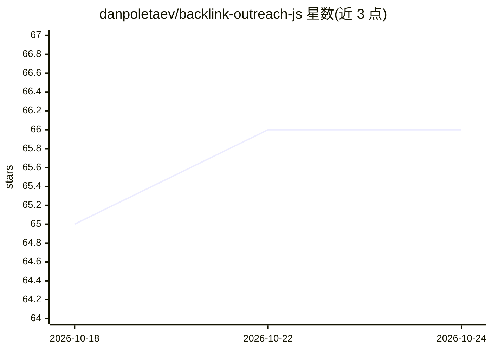

# danpoletaev/backlink-outreach-js

⭐ 66 · TypeScript · 推送 2026-03-12 · [GitHub](https://github.com/danpoletaev/backlink-outreach-js) · [官网](https://apify.com/daniil.poletaev/backlink-outreach-js) · 个人维护

**SEO 外链建设的自动化外联 Agent：找站、取联系方式、生成个性化消息**

运行在 Apify 平台上的开源 Actor，自动化外链建设流程：按关键词从 SERP 识别潜在外链合作站点，过滤直接竞品（excludeDomains），从入围页面提取联系邮箱与社媒链接，再基于目标页面 Markdown 生成覆盖邮件、LinkedIn、Twitter、Facebook 的个性化外联消息序列（1 条主消息+2 条跟进）。输出 JSON 可接入 Make、n8n 或 Hubspot/Salesforce/Attio 等 CRM。采用按事件计费（$0.05/序列），依赖 Apify 与 OpenAI 运行。

## 筛选速览

| 维度 | 判定 | 备注 |
|---|---|---|
| AI 角色 | `ai-enhanced` | 去掉 AI 部分产品仍成立 |
| 许可风险 | `none` | — |
| 部署形态 | `library` | 以包/库形式分发 |
| 模型依赖 | — | README 未给出锁定关系 |
| 硬件要求 | — | 无带数字的原话,不猜 |
| 安装摩擦 | `low` | 无编译、无系统依赖或容器化 |
| 成熟度 | — | 结构信号不足 |

## 能力要点

- 关键词 SERP 搜索识别外链机会并按排除域名过滤
- 从入围页面/域名提取邮箱与社媒联系方式
- 为 4 个渠道生成 3 条式个性化外联消息序列
- 输出可经 Make/n8n/webhook 接入 CRM 与自动化工具

## 适用场景

- SEO 团队按目标关键词批量寻找外链合作网站
- 自动化获取站长联系方式并发送个性化外联
- 把外联消息序列同步进 Hubspot 等营销自动化流程

## 场景标签

`网页抓取` `AI 写作` · 领域:效率与自动化

## 证据(README 行号)

> L5: The Backlink Building Agent is an automated agent designed to automate link-building efforts, a key component of bui
> L24:  Generate personalized outreach messages on email, Linkedin, Twitter, Facebook based on the Markdown of the targete

## 星数曲线

2026-10-18 65 → 2026-10-24 66（+1）

---
*卡片 v1 · prompt 1.4 · 生成 2026-10-24 · 置信度 low · 依据 README sha `285d01156715` · [字段定义](../../DATASET.md)*
