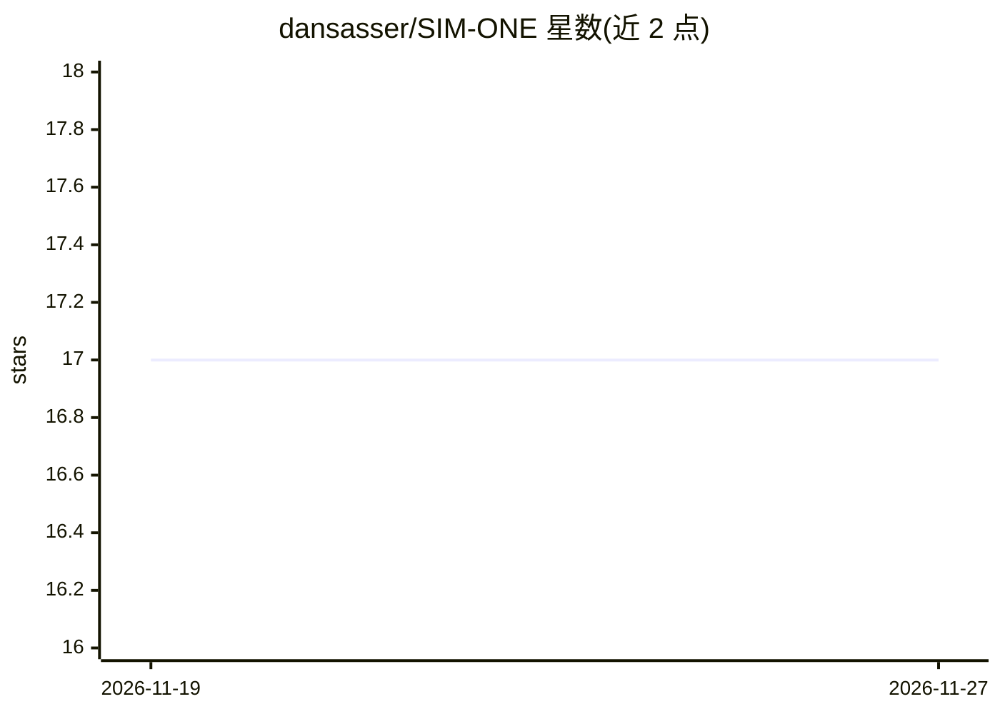

# dansasser/SIM-ONE

⭐ 17 · Python · NOASSERTION · 推送 2026-11-18 · [GitHub](https://github.com/dansasser/SIM-ONE) · [官网](https://dansasser.me/posts/the-sim-one-manifesto-a-new-architecture-for-governed-cognition/) · 个人维护

**面向 AI 开发者的认知治理框架：以协议协调规范 AI 推理输出**

SIM-ONE 是一个包含 MANIFESTO、架构原则与 Python 实现的框架，提出『治理认知』五法则（架构智能、认知治理、真理基础、能量节制、确定性可靠性），通过九个认知协议（CCP/REP/VVP 等）加治理引擎实现响应校验、合规报告与实时监控。提供 CLI 工具入口供 Paper2Agent 类自主 agent 集成，可校验任意 AI 生成响应。README 含大量自我宣称性表述（如 AGI 级能力、67% 能效提升），编目仅按可验证内容收录。需 Python 3.8+ 与 SQLite。

## 筛选速览

| 维度 | 判定 | 备注 |
|---|---|---|
| AI 角色 | `ai-ecosystem` | LLM/agent 周边工具 |
| 许可风险 | `none` | NOASSERTION |
| 部署形态 | `None` |  |
| 模型依赖 | — | README 未给出锁定关系 |
| 硬件要求 | — | 无带数字的原话,不猜 |
| 安装摩擦 | `low` | 无编译、无系统依赖或容器化 |
| 成熟度 | `idea` | |

## 能力要点

- 提供 Five Laws Validator 等 CLI 工具，校验任意 AI 生成响应的合规性
- 九个认知协议与治理引擎的 Python 实现（自述 32,420+ 行代码）
- 支持多 agent 协调与动态协议加载的 MCP 服务器（Multi-Protocol Cognitive Platform，非 Model Context Protocol）
- 实时监控栈：系统健康跟踪与 Five Laws 合规报告

## 适用场景

- 给自主 agent 的 AI 输出做 Five Laws 合规校验
- 为 AI 响应生成增加治理与真理性验证环节
- 研究协议驱动的认知架构设计

## 场景标签

`模型评测` · 领域:评测与运维

## 证据(README 行号)

> L67: ## 🛠️ Tool Entrypoints for AI Agent Integration
> L155: - ✅ **Five Laws Validators** – **Production-ready implementation** with real-time compliance monitoring

## 星数曲线

2026-11-19 17 → 2026-11-27 17（+0）

---
*卡片 v1 · prompt 1.4 · 生成 2026-11-19 · 置信度 mid · 依据 README sha `e4553df3320d` · [字段定义](../../DATASET.md)*
