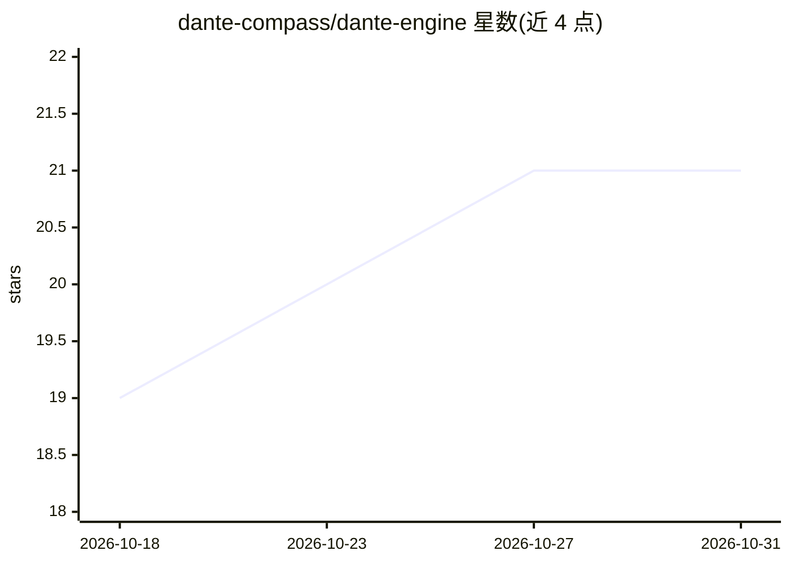

# dante-compass/dante-engine

⭐ 21 · Java · Apache-2.0 · 推送 2026-10-30 · [GitHub](https://github.com/dante-compass/dante-engine) · [官网](https://www.herodotus.cn) · 个人维护 · 中文 README

**Dante Cloud 微服务体系的核心 Java 组件库，含 AI Agent 基座组件**

Dante Engine 是 Dante Cloud 企业级微服务项目的核心组件库工程，从主工程中拆出以便多项目共享代码并发布至 Maven 中央仓库。所属 Dante Cloud 基于 Spring Boot 4.1 / Spring Cloud 2025.1 / Spring AI 2.0.2 构建，采用 DDD 设计，支持阻塞式与响应式服务并行、微服务与单体架构一套代码切换，覆盖 OAuth2 认证、国密数字信封加密、多租户、IoT 设备认证等能力，并面向 AI Agent 开发提供智能基座。协议为 Apache 2.0 并附加补充条款，历史分支已停止维护。

## 筛选速览

| 维度 | 判定 | 备注 |
|---|---|---|
| AI 角色 | `ai-ecosystem` | LLM/agent 周边工具 |
| 许可风险 | `permissive` | Apache-2.0 |
| 部署形态 | `None` |  |
| 模型依赖 | — | README 未给出锁定关系 |
| 硬件要求 | — | 无带数字的原话,不猜 |
| 安装摩擦 | `medium` | 含编译或系统依赖之一 |
| 成熟度 | — | 结构信号不足 |

## 能力要点

- Dante Cloud 微服务系统的核心组件库，已发布 Maven 中央仓库
- 支持阻塞式与响应式服务并行、微服务/单体架构一套代码切换
- 基于 Spring AI 2.0.2，面向 AI Agent 开发的智能基座
- 包含国密数字信封加解密、多租户、IoT 设备认证等安全体系组件

## 适用场景

- 作为自研企业微服务系统的可复用组件库
- 搭建支持 AI Agent 的企业级智能应用基座
- 复用 OAuth2 认证、国密加密、多租户等基础组件

## 场景标签

`Agent 框架` · 领域:Agent 开发

## 证据(README 行号)

> L35: **Dante Cloud** 国内首个支持阻塞式和响应式服务并行的、开箱即用的企业级云原生微服务基座和面向 AI Agent 开发的智能基座。是采用**领域驱动模型(DDD)**设计思想，以「**高质量代码、低安全漏洞**」为核
> L37: Dante Engine 为 Dante Cloud 微服务项目核心组件库，是 Dante Cloud 项目核心内容。单独提取一个工程，一方面便于多项目共享代码，提升代码维护的便捷性；另一方面，Dante Engine 已经提前编
> L9:  Spring AI 2.0.2

## 星数曲线

2026-10-18 19 → 2026-10-31 21（+2）

---
*卡片 v1 · prompt 1.4 · 生成 2026-10-28 · 置信度 mid · 依据 README sha `d4d39458b8fc` · [字段定义](../../DATASET.md)*
