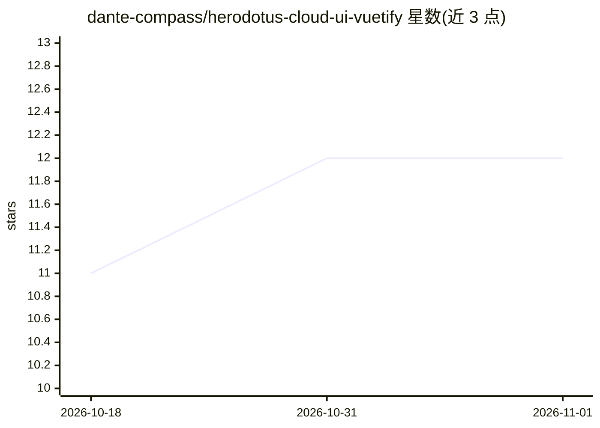

# dante-compass/herodotus-cloud-ui-vuetify

⭐ 12 · Vue · Apache-2.0 · 推送 2026-10-31 · [GitHub](https://github.com/dante-compass/herodotus-cloud-ui-vuetify) · [官网](https://www.herodotus.cn) · 组织维护 · 中文 README

**Dante Cloud 微服务基座的新版前端管理界面（Vuetify 版）**

Herodotus Cloud UI Vuetify 是 Dante Cloud 4.4.X 微服务/单体基座的前端工程，基于 Vue 3 组合式 API 与 Vuetify Material Design 3 构建，采用 monorepo 模块化设计与 Quasar 旧版共享通用代码。功能包括多角色动态菜单、OAuth2 密码/授权码模式登录、OIDC、多租户配置、前后端国密 SM4/SM2 数字信封加密传输、WebSocket 等。支持开发模式（pnpm 编译运行）与生产模式（Nginx 手动部署或打包为 Docker 镜像，可通过环境变量动态修改参数），同一套界面适配微服务版与单体版后端。

## 筛选速览

| 维度 | 判定 | 备注 |
|---|---|---|
| AI 角色 | `ai-enhanced` | 去掉 AI 部分产品仍成立 |
| 许可风险 | `permissive` | Apache-2.0 |
| 部署形态 | `self-host` | docker 或自建部署 |
| 模型依赖 | — | README 未给出锁定关系 |
| 硬件要求 | — | 无带数字的原话,不猜 |
| 安装摩擦 | `low` | 无编译、无系统依赖或容器化 |
| 成熟度 | — | 结构信号不足 |

## 能力要点

- 一套前端代码适配微服务版（dante/herodotus）与单体版（athena）后端
- 基于自定义数据传输 Session 实现国密 SM4/SM2 一人一钥动态加密传输
- monorepo 设计，Quasar 旧版与 Vuetify 新版共享通用代码模块
- 支持打包为 Docker 镜像并通过环境变量动态修改部署参数

## 适用场景

- 为 Dante Cloud 微服务或单体后端搭建配套的管理前端
- 企业级多租户、多角色动态菜单的管理系统界面
- 以 Docker 方式快速部署前端并通过环境变量调整配置

## 场景标签

 · 领域:微服务/云原生前端工程

## 证据(README 行号)

> L38: Herodotus Cloud UI Vuetify 为 Dante Cloud 微服务项目新版前端项目。
> L46: 1. 基于 Vuetify `Material Design 3` 蓝图风格以及 Vue 3 组合式 API，全新编写新版管理界面，更符合目前主流设计风格。

## 星数曲线

2026-10-18 11 → 2026-11-01 12（+1）

---
*卡片 v1 · prompt 1.4 · 生成 2026-11-01 · 置信度 mid · 依据 README sha `c81f50987be4` · [字段定义](../../DATASET.md)*
