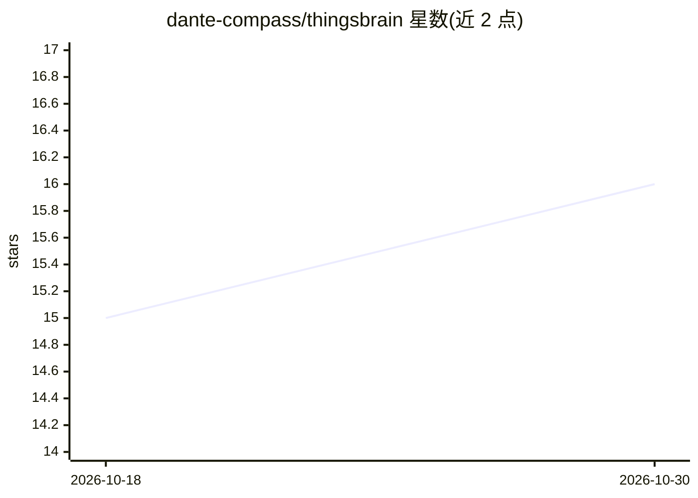

# dante-compass/thingsbrain

⭐ 16 · Java · Apache-2.0 · 推送 2026-10-29 · [GitHub](https://github.com/dante-compass/thingsbrain) · [官网](https://www.herodotus.cn) · 个人维护 · 中文 README

**基于 Dante Cloud 构建的企业级物联网平台，兼容阿里云物联网平台标准**

ThingsBrain 是基于 Dante Cloud 微服务基座构建的物联网平台，面向企业级物联网应用场景。功能覆盖多协议设备接入（MQTT/HTTPS 等）、物模型、设备影子、规则引擎、告警中心、OTA 升级等物联网平台主流功能，并在设备接入认证与物模型层面兼容阿里云物联网平台规范。支持一套代码以单体或微服务模式运行，提供独立部署、微服务融合、单体模块三种形态。构建于 Spring Boot 4 / JDK 25 技术栈，集成 Spring AI，规划了边缘计算与 AI 协同能力。注意：README 未给出安装运行命令；开源协议为 Apache 2.0 附加补充条款（禁止二次开源、限制删除版权信息）。

## 筛选速览

| 维度 | 判定 | 备注 |
|---|---|---|
| AI 角色 | `ai-enhanced` | 去掉 AI 部分产品仍成立 |
| 许可风险 | `permissive` | Apache-2.0 |
| 部署形态 | `None` |  |
| 模型依赖 | — | README 未给出锁定关系 |
| 硬件要求 | — | 无带数字的原话,不猜 |
| 安装摩擦 | `medium` | 含编译或系统依赖之一 |
| 成熟度 | — | 结构信号不足 |

## 能力要点

- 兼容阿里云物联网平台三元组认证与物模型规范，支持存量设备迁移
- 一套代码支持单体与微服务两种架构，三种部署形态
- 多协议（MQTT/HTTPS 等）、多存储可插拔架构
- 阻塞式与响应式并行的混合运行时架构

## 适用场景

- 企业搭建自有物联网平台，管理设备接入与数据采集
- 从阿里云物联网平台平滑迁移存量设备
- 按项目规模在单体与微服务模式间弹性演进

## 场景标签

 · 领域:物联网/企业级平台

## 证据(README 行号)

> L30: # ThingsBrain 企业级物联网平台
> L95: - **主流功能全覆盖**：完整支持设备生命周期管理、在线状态监控、设备影子、数据解析、规则引擎、数据转发、告警中心、可视化监控、OTA 升级等物联网平台主流功能
> L99: Dante Cloud 4.X已为AI时代的技术演进预留了底座支持，ThingsBrain在此基础上构建，具备从设备接入、数据采集到AI推理的完整数据链路能力，为万物互联与AI融合提供高可靠、高安全的一站式基座。

## 星数曲线

2026-10-18 15 → 2026-10-30 16（+1）

---
*卡片 v1 · prompt 1.4 · 生成 2026-10-30 · 置信度 high · 依据 README sha `2209a6400add` · [字段定义](../../DATASET.md)*
