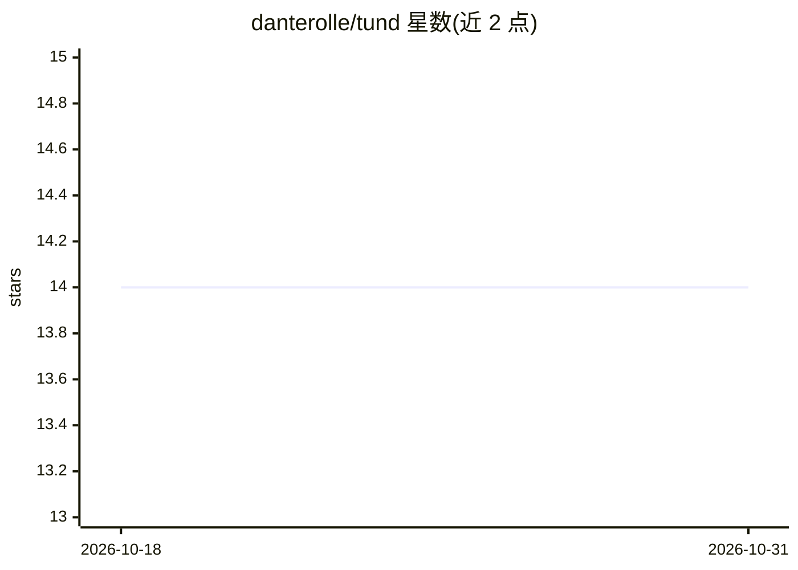

# danterolle/tund

⭐ 14 · C · MIT · 推送 2026-08-14 · [GitHub](https://github.com/danterolle/tund) · [官网](https://danterolle.github.io/tund/) · 个人维护

**自建虚拟局域网工具：UDP 隧道组建 10.9.0.0/24 联机子网**

面向 LAN-party 联机与直连 IP 多人游戏的虚拟 LAN 工具：一台机器以服务器模式运行，其他机器以客户端经 UDP 隧道接入，自动分配 10.9.0.0/24 虚拟 IP 并支持 IPv4 广播。C11 核心依赖少（Linux/macOS 用系统网络 API，Windows 用 Wintun），另提供 Flutter 桌面 GUI。加密为端点至服务器的传输加密，服务器会解密转发，非端到端；README 明确建议有端到端保密需求者改用 WireGuard/Tailscale/ZeroTier。开发过程中使用了 AI 辅助编程。

## 筛选速览

| 维度 | 判定 | 备注 |
|---|---|---|
| AI 角色 | `ai-enhanced` | 去掉 AI 部分产品仍成立 |
| 许可风险 | `permissive` | MIT |
| 部署形态 | `desktop` | 安装包/桌面程序 |
| 模型依赖 | — | README 未给出锁定关系 |
| 硬件要求 | — | 无带数字的原话,不猜 |
| 安装摩擦 | `low` | 无编译、无系统依赖或容器化 |
| 成熟度 | — | 结构信号不足 |

## 能力要点

- UDP 隧道组建固定 10.9.0.0/24 虚拟子网，自动发现与分配对端 IP
- 传输加密且拒绝重放数据报，但非对服务器的端到端加密
- 零注册、NAT 友好，单一 CLI 二进制含服务器与客户端模式
- 跨 Windows/macOS/Linux，附可选 Flutter 桌面 GUI

## 适用场景

- 和朋友跨互联网玩直连 IP 的联机游戏
- 物理 LAN 不稳定时搭建临时虚拟局域网
- 为 Artemis 等使用 IPv4 广播的局域网游戏提供联机子网

## 场景标签

 · 领域:网络/游戏联机工具

## 证据(README 行号)

> L46: AI was used as a pair-programming assistant during development. The C core matches my own experience and was review
> L48: The Flutter GUI is different: I do not know Flutter well. It exists because it was the quickest practical way to pr

## 星数曲线

2026-10-18 14 → 2026-10-31 14（+0）

---
*卡片 v1 · prompt 1.4 · 生成 2026-10-31 · 置信度 low · 依据 README sha `7f757860da2f` · [字段定义](../../DATASET.md)*
