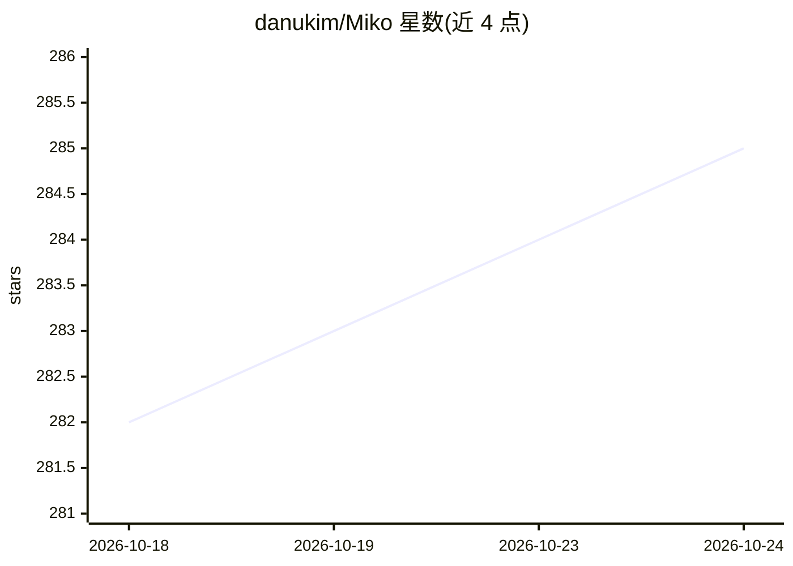

# danukim/Miko

⭐ 285 · C# · GPL-3.0 · 推送 2026-09-27 · [GitHub](https://github.com/danukim/Miko) · [官网](https://www.youtube.com/@0neReality) · 个人维护

**Windows 桌面 3D AI 伙伴：Ollama 本地大模型 + 双语音合成**

运行于 Windows 桌面的具身 AI 陪伴应用：通过 Ollama 加载本地 LLM（如 qwen2.5:7b、llama3），提供语音/文本双交互模式（Push-to-Talk 或持续监听，STT 用 RealtimeSTT/Whisper）。TTS 支持两条路径：Fish Audio S2.1 Pro 云端 WebSocket 流式合成（需 API key，不占本地 GPU）或 GPT-SoVITS v2pro 本地离线语音克隆（建议 NVIDIA GPU）。附带 Unity 无边框透明 3D 桌面化身，支持实时口型同步、.VRM 自定义模型上传、带时间衰减与向量检索的记忆系统、智能家居 IoT 控制及 OASIS 硬件集成。平台仅限 Windows 10/11，Python 3.10+，经 setup.bat 自动安装。

## 筛选速览

| 维度 | 判定 | 备注 |
|---|---|---|
| AI 角色 | `ai-native` | 本体是模型或模型工具 |
| 许可风险 | `viral` | GPL-3.0 |
| 部署形态 | `desktop` | 安装包/桌面程序 |
| 模型依赖 | local-ok | 支持本地模型 |
| 硬件要求 | — | 无带数字的原话,不猜 |
| 安装摩擦 | `low` | 无编译、无系统依赖或容器化 |
| 成熟度 | — | 结构信号不足 |

## 能力要点

- 双 TTS 引擎：Fish Audio 云端流式与 GPT-SoVITS 本地离线克隆
- Unity 3D 桌面化身：实时口型同步、.VRM 模型实时替换、点击穿透
- 记忆系统含时间衰减、重要性评分与向量检索
- LLM 未完成生成前即按句分块流式播放音频

## 适用场景

- 在 Windows 桌面常驻一个可语音对话的 3D 动漫伙伴
- 完全离线运行以保护隐私（GPT-SoVITS 本地语音 + Ollama 本地模型）
- 上传自己的 .VRM 模型替换默认化身

## 场景标签

`语音 Agent` `聊天机器人` · 领域:对话与助手

## 证据(README 行号)

> L15: **Miko** is a real-time, interactive AI companion designed to live on your Windows desktop. She pairs local Large L
> L25:     User([User Voice / Text]) --> STT[RealtimeSTT / Whisper]
> L141: 1. **Voice Mode (Default)**:

## 星数曲线

2026-10-18 282 → 2026-10-24 285（+3）

---
*卡片 v1 · prompt 1.4 · 生成 2026-10-22 · 置信度 high · 依据 README sha `4daa0541ae45` · [字段定义](../../DATASET.md)*
