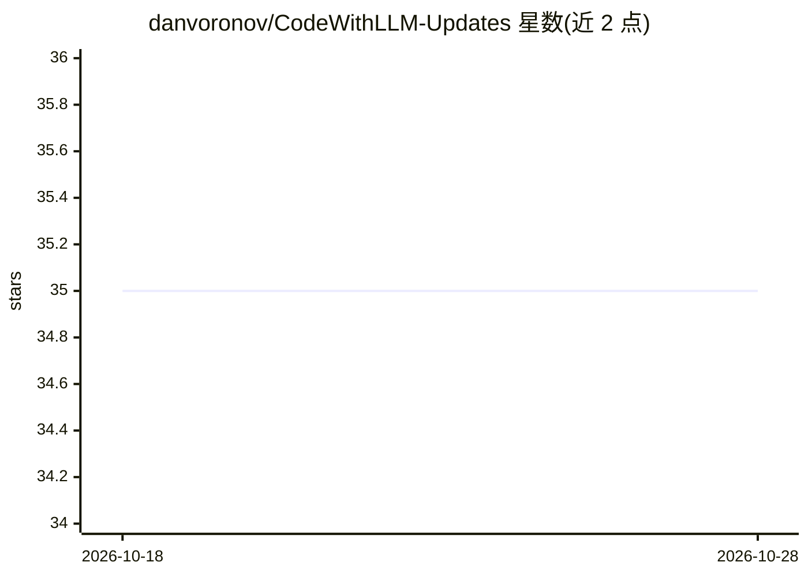

# danvoronov/CodeWithLLM-Updates

⭐ 35 · JavaScript · 推送 2026-10-26 · [GitHub](https://github.com/danvoronov/CodeWithLLM-Updates) · [官网](https://aicode.danvoronov.com) · 个人维护

**用 LLM 辅助编程的技巧与教程资源库**

面向程序员、初创团队与 AI 爱好者的 LLM 编程学习资源仓库：收录 2023-24 年讲义幻灯片、实用技巧、模型集成示例（GPT、Claude、CodeLLaMA 等）、VSCode 插件与 API 及本地方案的配置指南、LLM 领域新闻更新、面向代码生成的模型对比分析以及视频推荐。内容以乌克兰语和英语双语呈现，并关联 Telegram 频道发布更新。仓库为资料集合，不提供可安装运行的软件。

## 筛选速览

| 维度 | 判定 | 备注 |
|---|---|---|
| AI 角色 | `ai-knowledge` | 知识聚合/清单类 |
| 许可风险 | `none` | — |
| 部署形态 | `None` |  |
| 模型依赖 | — | README 未给出锁定关系 |
| 硬件要求 | — | 无带数字的原话,不猜 |
| 安装摩擦 | `low` | 无编译、无系统依赖或容器化 |
| 成熟度 | — | 结构信号不足 |

## 能力要点

- 收录 2023-24 年讲义幻灯片
- GPT/Claude/CodeLLaMA 等模型的项目集成示例
- VSCode 插件、生成代码 API 与本地方案的配置指南
- 面向代码生成的 LLM 对比分析

## 适用场景

- 学习如何用 LLM 生成、优化和检查代码
- 为团队选型查找 LLM 编程工具的对比信息
- 跟踪 LLM 编程领域的新模型与新闻

## 场景标签

`教程课程` · 领域:学习与行业

## 证据(README 行号)

> L7: Інформація присвячена використанню великих мовних моделей (LLM) для програмування! Тут ви знайдете корисні поради, п
> L53: Welcome to the repo dedicated to using large language models (LLM) for programming! Here you'll find useful tips, e

## 星数曲线

2026-10-18 35 → 2026-10-28 35（+0）

---
*卡片 v1 · prompt 1.4 · 生成 2026-10-25 · 置信度 high · 依据 README sha `930ec4ef323b` · [字段定义](../../DATASET.md)*
