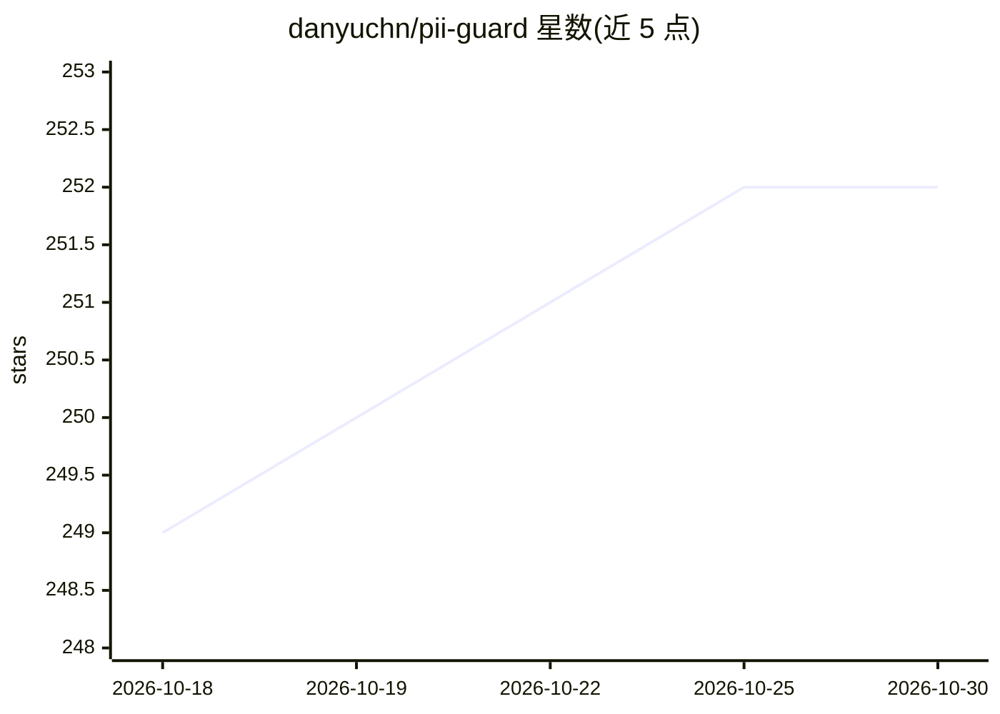

# danyuchn/pii-guard

⭐ 252 · Python · MIT · 推送 2026-10-25 · [GitHub](https://github.com/danyuchn/pii-guard) · 个人维护 · 中文 README

**繁中（台湾）个资去识别化工具：文件遮蔽后送 AI、可逐字还原**

面向繁体中文（台湾）文件的可逆个资去识别化工具：以 Microsoft Presidio + 中研院 CKIP BERT NER + 自建台湾 Regex 检测身份证号、统一编号、本地电话、繁中人名/组织名等 PII，替换与还原由纯代码完成以保证逐字精确；产出可留存的去识别化副本而非逐次代理。检测与还原全程本地运行，核心快速模式不需启动 Ollama，可选加 强模式用 Ollama 做三次本地稽核。提供 CLI、localhost 人工补标网页、PDF 快审，并附 Claude Code skill 隔离原始文件不被云端 agent 读取。限制：纯文字输入 64 KiB 上限，加强模式单份 10–50 分钟，扫描型 PDF 与 OCR未支持。

## 筛选速览

| 维度 | 判定 | 备注 |
|---|---|---|
| AI 角色 | `ai-ecosystem` | LLM/agent 周边工具 |
| 许可风险 | `permissive` | MIT |
| 部署形态 | `desktop` | 安装包/桌面程序 |
| 模型依赖 | local-ok | 支持本地模型 |
| 硬件要求 | — | 无带数字的原话,不猜 |
| 安装摩擦 | `low` | 无编译、无系统依赖或容器化 |
| 成熟度 | — | 结构信号不足 |

## 能力要点

- Presidio + CKIP BERT NER + 台湾 Regex 三层检测，覆盖 13+ 类台湾 PII
- 替换与还原由代码完成，还原逐字精确，全程本地运行
- localhost 人工补标接口：补遮漏网、放回误遮，一次性 token 防外部连入
- Claude Code skill 与常驻 hook：主 agent 只拿到路径与回执，读不到原文

## 适用场景

- 把判决书、病历等机敏繁中文件遮个资后再交给云端 AI 处理
- AI 回答后用对照表把代精确换回真名
- 在本地浏览器逐笔补遮漏网个资或放回被误遮的机构名

## 场景标签

 · 领域:隐私/LLM 输入安全

## 证据(README 行号)

> L3: 繁體中文（台灣）個人資料去識別化工具。把文件裡的個資換成可還原的代號，讓你能用雲端 AI 處理機敏文件，處理完再換回來。**偵測與還原全程在你自己的機器上跑。**
> L11: This fills that gap, and differs in one more way: it produces a **redacted file you can keep and hand to someone**,
> L161: 快速模式不啟動或呼叫 Ollama，只使用既有的 Presidio、台灣規則與 CKIP 中文辨識；反向對照表與原文快照留在 `~/.local/share/pii-safe-documents/jobs/<job_id>/`，

## 星数曲线

2026-10-18 249 → 2026-10-30 252（+3）

---
*卡片 v1 · prompt 1.4 · 生成 2026-10-22 · 置信度 high · 依据 README sha `d1ff67fc2a5a` · [字段定义](../../DATASET.md)*
