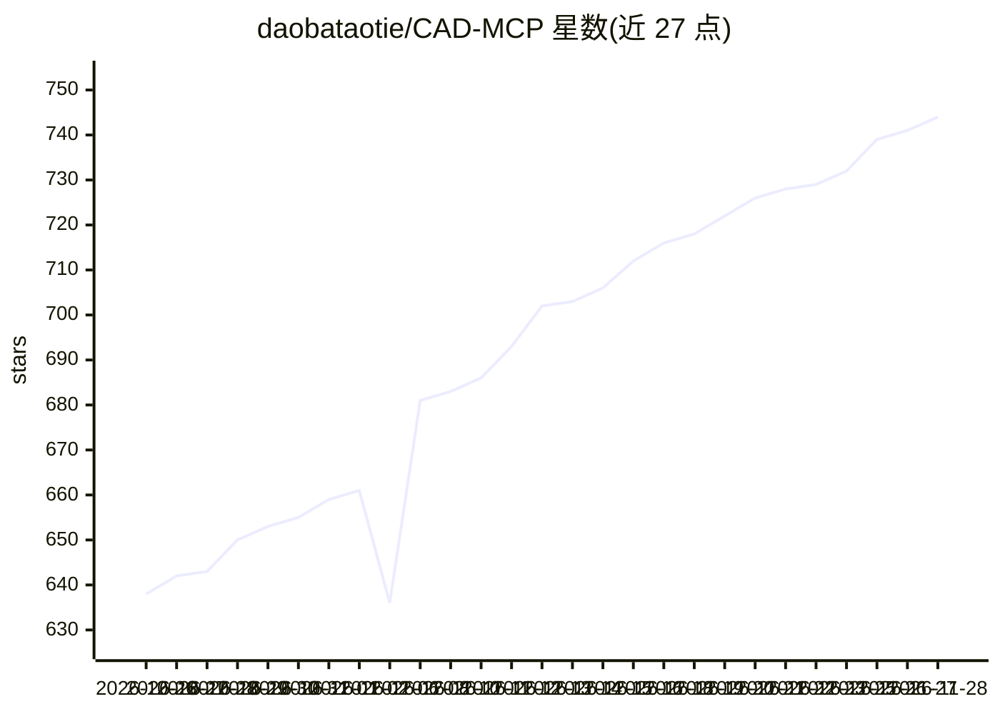

# daobataotie/CAD-MCP

⭐ 744 · Python · MIT · 推送 2026-10-27 · [GitHub](https://github.com/daobataotie/CAD-MCP) · 个人维护 · 中文 README

**MCP 服务器：让 AI 客户端经自然语言操控 CAD 绘图**

基于 MCP 协议的 CAD 控制服务，通过 Windows COM 接口连接 AutoCAD、GstarCAD、ZWCAD，向 Claude Desktop、Cursor 等 MCP 客户端暴露 35 个工具，覆盖绘图、查询、编辑、图层、图纸管理与命令透传，支持实体句柄级的读取与修改及截图预览。v2.0 遵循 FastMCP 规范，提供结构化输出、工具注解、进度通知，并支持 stdio 与 Streamable HTTP 双传输模式。仅限 Windows，需已安装受支持的 CAD 软件与 Python 3.10+。

## 筛选速览

| 维度 | 判定 | 备注 |
|---|---|---|
| AI 角色 | `ai-ecosystem` | LLM/agent 周边工具 |
| 许可风险 | `permissive` | MIT |
| 部署形态 | `library` | 以包/库形式分发 |
| 模型依赖 | — | README 未给出锁定关系 |
| 硬件要求 | — | 无带数字的原话,不猜 |
| 安装摩擦 | `low` | 无编译、无系统依赖或容器化 |
| 成熟度 | — | 结构信号不足 |

## 能力要点

- 35 个 MCP 工具覆盖绘图、查询、编辑、图层、图纸、块与命令透传
- 支持 AutoCAD、GstarCAD、ZWCAD，经 COM 接口控制
- stdio 与 Streamable HTTP 双传输模式，可多客户端共享一个 CAD 实例
- 查询工具返回实体句柄与属性，截图预览形成校验回路

## 适用场景

- 在 Claude Desktop / Cursor 中用对话指令创建和修改 CAD 图纸
- 让 AI 读取图纸实体属性后进行编辑修正
- 通过 Streamable HTTP 让多个客户端共享一个 CAD 实例

## 场景标签

`GUI 自动化` · 领域:效率与自动化

## 证据(README 行号)

> L7: CAD-MCP is an innovative CAD control service that allows controlling CAD software for drawing operations through nat
> L9: Version 2.0 is fully upgraded based on the latest MCP specification (FastMCP, structured output, tool annotations, p
> L42: - **Dual Transport Modes**: `stdio` (local, single client) and `streamable-http` (remote / multiple clients sharing

## 星数曲线

2026-10-26 638 → 2026-11-28 744（+106）

---
*卡片 v1 · prompt 1.4 · 生成 2026-11-24 · 置信度 mid · 依据 README sha `d480a7bfc542` · [字段定义](../../DATASET.md)*
