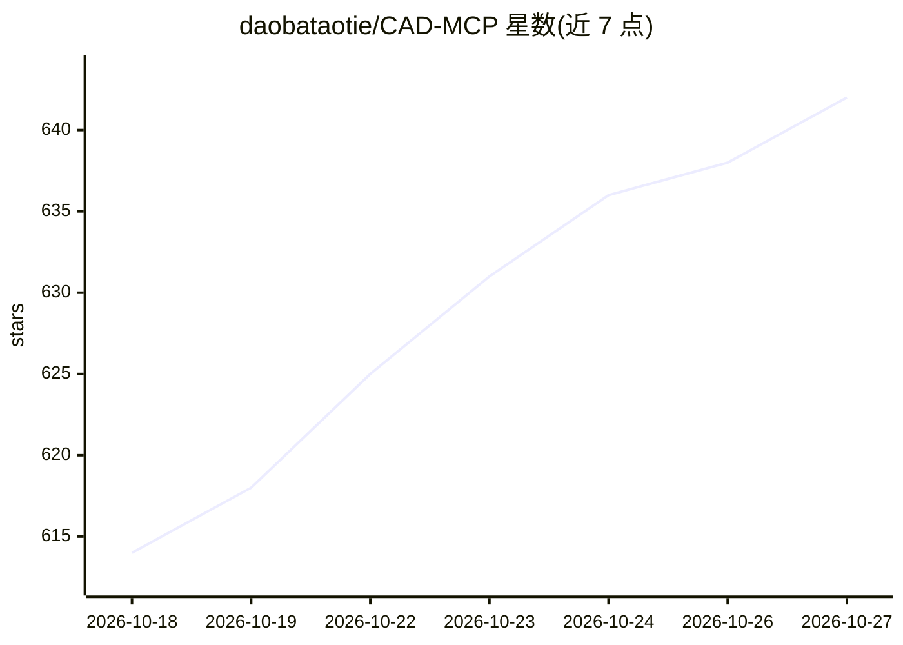

# daobataotie/CAD-MCP

⭐ 642 · Python · MIT · 推送 2026-10-26 · [GitHub](https://github.com/daobataotie/CAD-MCP) · 个人维护 · 中文 README

**通过自然语言/MCP 控制 AutoCAD 等 CAD 软件绘图的 MCP 服务器**

面向 Windows 的 CAD 控制 MCP 服务器，基于 FastMCP 规范提供 35 个工具，覆盖画线/圆/文字等基本绘图、图层与图纸管理（DWG/DXF）、块操作、实体查询与截图预览、编辑变换及任意命令透传，形成“画→查→改”反馈闭环。通过 pywin32 COM 接口驱动 AutoCAD、GstarCAD、ZWCAD，支持 stdio 与 Streamable HTTP 双传输，可接入 Claude Desktop、Cursor 等 MCP 客户端。需 Python 3.10+ 与已安装的 CAD 软件。

## 筛选速览

| 维度 | 判定 | 备注 |
|---|---|---|
| AI 角色 | `ai-ecosystem` | LLM/agent 周边工具 |
| 许可风险 | `permissive` | MIT |
| 部署形态 | `library` | 以包/库形式分发 |
| 模型依赖 | — | README 未给出锁定关系 |
| 硬件要求 | — | 无带数字的原话,不猜 |
| 安装摩擦 | `low` | 无编译、无系统依赖或容器化 |
| 成熟度 | — | 结构信号不足 |

## 能力要点

- 35 个 MCP 工具：绘图/查询/编辑/图层/图纸/块/命令透传
- 支持 AutoCAD、GstarCAD、ZWCAD 三类 CAD 软件
- stdio 与 Streamable HTTP 双传输模式，支持多客户端共享
- 结构化输出、工具注解（readOnly/destructive）与进度通知

## 适用场景

- 在 Claude/Cursor 等 MCP 客户端里用自然语言驱动 CAD 绘图
- 让 AI 查询并修改已有 CAD 图纸中的实体
- 通过截图预览让模型核验绘制结果并自动纠正

## 场景标签

`GUI 自动化` · 领域:效率与自动化

## 证据(README 行号)

> L7: CAD-MCP is an innovative CAD control service that allows controlling CAD software for drawing operations through nat
> L9: Version 2.0 is fully upgraded based on the latest MCP specification (FastMCP, structured output, tool annotations, p
> L42: - **Dual Transport Modes**: `stdio` (local, single client) and `streamable-http` (remote / multiple clients sharing

## 星数曲线

2026-10-18 614 → 2026-10-27 642（+28）

---
*卡片 v1 · prompt 1.4 · 生成 2026-10-21 · 置信度 mid · 依据 README sha `3c34567fdbb9` · [字段定义](../../DATASET.md)*
