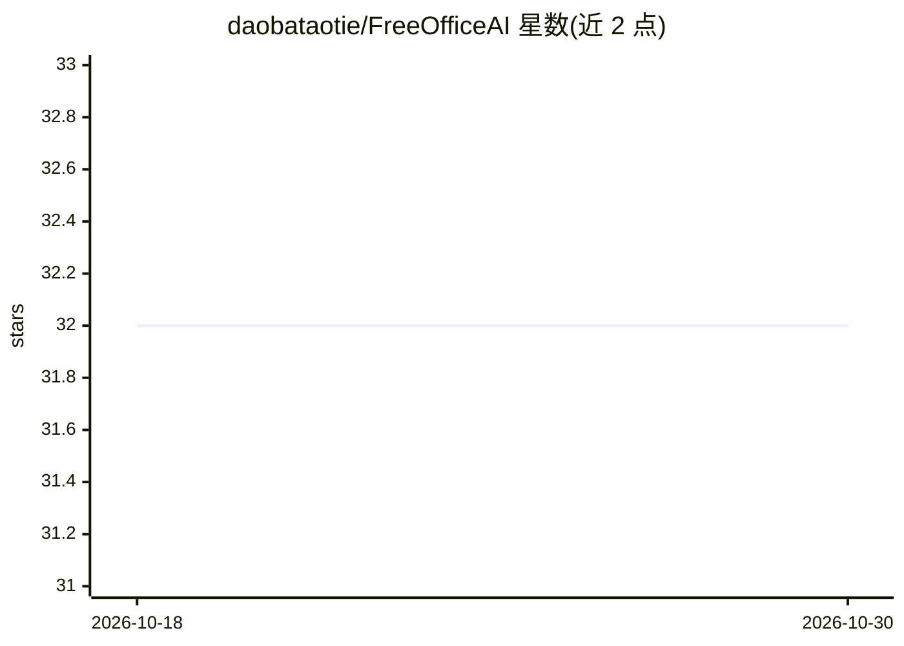

# daobataotie/FreeOfficeAI

⭐ 32 · C# · Apache-2.0 · 推送 2026-09-03 · [GitHub](https://github.com/daobataotie/FreeOfficeAI) · 个人维护 · 中文 README

**集成到 Word/Excel 的免费 Office AI 助手插件**

基于 VSTO 的 Office 插件项目，通过本地 Ollama 部署大模型并在 OllamaApi 中配置 API。Word 侧提供总结提炼、合同检查、纠错矫正、翻译与连续对话功能；Excel 侧提供对话和公式功能，AI 可编写 VBA 自动处理文档。安装需用 Visual Studio 打开项目、编译解决方案并重新生成 Setup 工程，产出 .msi 安装包安装，支持自动覆盖低版本升级。

## 筛选速览

| 维度 | 判定 | 备注 |
|---|---|---|
| AI 角色 | `ai-enhanced` | 去掉 AI 部分产品仍成立 |
| 许可风险 | `permissive` | Apache-2.0 |
| 部署形态 | `None` |  |
| 模型依赖 | local-ok | 支持本地模型 |
| 硬件要求 | — | 无带数字的原话,不猜 |
| 安装摩擦 | `low` | 无编译、无系统依赖或容器化 |
| 成熟度 | — | 结构信号不足 |

## 能力要点

- Word 支持总结提炼、合同检查、纠错矫正、翻译、对话
- Excel 通过 AI 编写 VBA 自动处理文档
- 通过本地 Ollama 部署大模型，无需外部 API
- 打包生成 .msi 安装包，支持版本自动覆盖升级

## 适用场景

- 在 Word 中做文档总结、纠错与合同检查
- 在 Excel 中用对话生成公式和 VBA 脚本处理表格
- 在本地部署大模型保护文档数据隐私

## 场景标签

`AI 助手` · 领域:对话与助手

## 证据(README 行号)

> L14: 2，通过VSTO集成到Word和Excel中
> L15: 3，Word支持总结提炼、合同检查、纠错矫正、翻译、对话功能
> L16: 4，Excel支持对话和公式(通过AI编写VBA自动处理文档)

## 星数曲线

2026-10-18 32 → 2026-10-30 32（+0）

---
*卡片 v1 · prompt 1.4 · 生成 2026-10-26 · 置信度 high · 依据 README sha `51e4466044f4` · [字段定义](../../DATASET.md)*
