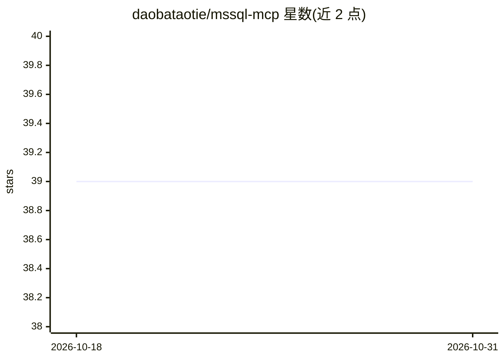

# daobataotie/mssql-mcp

⭐ 39 · Python · MIT · 推送 2026-09-04 · [GitHub](https://github.com/daobataotie/mssql-mcp) · 个人维护 · 中文 README

**连接 LLM 与 SQL Server 的 MCP 服务器：查询、写入与业务洞察**

基于官方 MCP Python SDK（FastMCP）的 MSSQL 数据库交互服务器，遵循 MCP 2025-06-18 规范，提供结构化工具输出与资源模板。工具覆盖 SQL 查询、写入、建表、存储过程执行、业务洞察备忘录等；支持在一个服务器挂载 dev/staging/prod 多连接，各自配置 readonly、超时、行数上限与写入确认。SQL 执行前经静态校验（白名单、拒绝多语句批处理、注释剥离），confirm_writes 依赖客户端 Elicitation 支持，不支持该协议的客户端会直接执行写入。需 Python 3.10+ 与 ODBC Driver 17/18。

## 筛选速览

| 维度 | 判定 | 备注 |
|---|---|---|
| AI 角色 | `ai-ecosystem` | LLM/agent 周边工具 |
| 许可风险 | `permissive` | MIT |
| 部署形态 | `library` | 以包/库形式分发 |
| 模型依赖 | — | README 未给出锁定关系 |
| 硬件要求 | — | 无带数字的原话,不猜 |
| 安装摩擦 | `low` | 无编译、无系统依赖或容器化 |
| 成熟度 | — | 结构信号不足 |

## 能力要点

- 多数据库连接挂载，各连接独立 readonly/超时/行数/写入确认配置
- SQL 白名单校验、只读模式、行数截断与查询超时等安全机制
- schema:// 资源模板按需提供表结构，不占用每轮工具 schema token
- 存储过程签名列举与执行，支持多结果集

## 适用场景

- 让 Claude Desktop/Cursor 等 MCP 客户端直接查询和分析 SQL Server 数据
- 在 LLM 对话中执行带确认机制的数据库写入操作
- 以只读连接隔离生产库，供 AI 安全取数

## 场景标签

`数据分析` · 领域:效率与自动化

## 证据(README 行号)

> L7: MSSQL MCP Server, provides database interaction and business intelligence capabilities. This server enables running 
> L10: Built on the official MCP Python SDK (FastMCP), supporting the MCP 2025-06-18 specification: structured tool output

## 星数曲线

2026-10-18 39 → 2026-10-31 39（+0）

---
*卡片 v1 · prompt 1.4 · 生成 2026-10-25 · 置信度 mid · 依据 README sha `ac79422572c9` · [字段定义](../../DATASET.md)*
