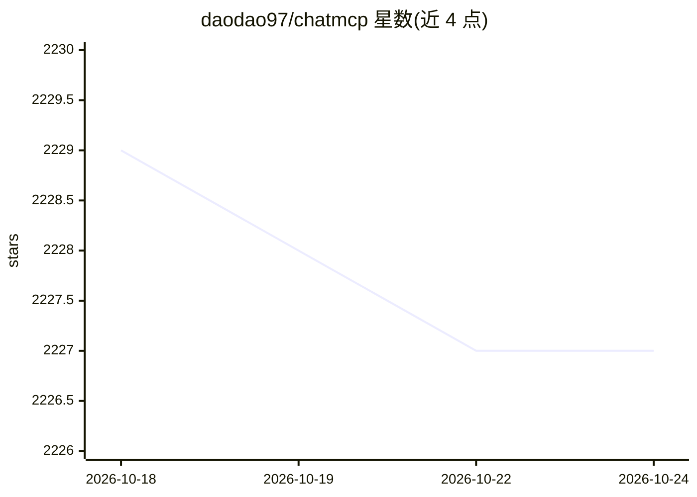

# daodao97/chatmcp

⭐ 2,226 · Dart · Apache-2.0 · 推送 2026-09-07 · [GitHub](https://github.com/daodao97/chatmcp) · [官网](https://daodao97.github.io/chatmcp/) · 个人维护 · 中文 README

**跨平台 MCP 协议 AI 聊天客户端**

基于 Flutter 的跨平台 AI 聊天客户端，覆盖 macOS、Windows、Linux、iOS、Android 与 Web，实现 Model Context Protocol（MCP）：用户配置 LLM API Key 与端点后，可从 MCP Server Market 安装 stdio/SSE 传输的 MCP Server 并与之对话。支持 OpenAI、Claude、Ollama、DeepSeek 模型，具备聊天历史、暗色/亮色主题、局域网数据同步、LaTeX/Mermaid/HTML 预览等功能；RAG 与 MCP Server 自动安装为未完成项。运行需系统安装 uvx 或 npx。

## 筛选速览

| 维度 | 判定 | 备注 |
|---|---|---|
| AI 角色 | `ai-native` | 本体是模型或模型工具 |
| 许可风险 | `permissive` | Apache-2.0 |
| 部署形态 | `library` | 以包/库形式分发 |
| 模型依赖 | local-ok | 支持本地模型 |
| 硬件要求 | — | 无带数字的原话,不猜 |
| 安装摩擦 | `low` | 无编译、无系统依赖或容器化 |
| 成熟度 | — | 结构信号不足 |

## 能力要点

- 支持 stdio 与 SSE 两种 MCP 传输方式
- MCP Server Market 内安装与添加 MCP Server
- 支持 OpenAI / Claude / Ollama / DeepSeek 模型
- 六端覆盖（含 Web 纯浏览器本地存储版本）

## 适用场景

- 在桌面或手机上通过统一客户端对话并调用 MCP 工具
- 从 MCP Server Market 安装不同 MCP Server 扩展聊天能力
- 同一局域网内多设备同步聊天数据

## 场景标签

`聊天机器人` · 领域:对话与助手

## 证据(README 行号)

> L4: Cross-platform `Macos | Windows | Linux | iOS | Android | Web` AI Chat Client
> L101: 3. Chat with MCP Server
> L270: - [x] Chat with MCP Server

## 星数曲线

2026-10-18 2,229 → 2026-10-24 2,227（-2）

---
*卡片 v1 · prompt 1.4 · 生成 2026-10-21 · 置信度 mid · 依据 README sha `ae5891a5dd9d` · [字段定义](../../DATASET.md)*
