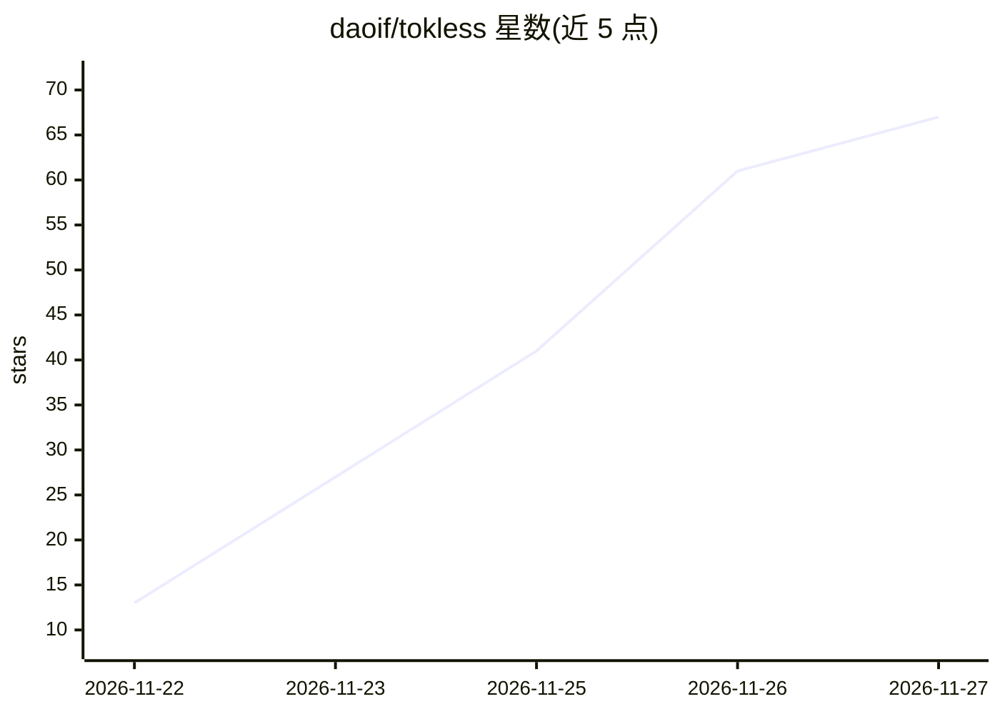

# daoif/tokless

⭐ 67 · JavaScript · MIT · 推送 2026-11-26 · [GitHub](https://github.com/daoif/tokless) · [官网](https://www.npmjs.com/package/tokless) · 个人维护 · 中文 README

**给 AI 编程 Agent 削减盲目读取与 Token 消耗的省流套件**

纯 Node.js 零依赖的 CLI 工具，为 AI 编程 Agent 提供：毫秒级语法骨架导航（输出 [L起-L止] 行号地图）、PreToolUse 钩子拦截无行号的整文件盲读、剥离 MCP Schema 的净身子角色，以及 0 Token 离线的本地 Token 账单体检。通过 npx 一键挂载到 Antigravity、Claude Code、Codex CLI；其他工具可用全局 CLI 配合 AGENTS.md 规范接入。README 中的 A/B 节省数据基于 v0.1.0 版本，新版未重跑对照。

## 筛选速览

| 维度 | 判定 | 备注 |
|---|---|---|
| AI 角色 | `ai-ecosystem` | LLM/agent 周边工具 |
| 许可风险 | `permissive` | MIT |
| 部署形态 | `library` | 以包/库形式分发 |
| 模型依赖 | — | README 未给出锁定关系 |
| 硬件要求 | — | 无带数字的原话,不猜 |
| 安装摩擦 | `low` | 无编译、无系统依赖或容器化 |
| 成熟度 | `idea` | |

## 能力要点

- 零外部依赖，纯 Node.js 标准库实现（>=18）
- skeleton 子命令提取多语言文件 [L起-L止] 行号骨架，无需预建索引
- PreToolUse 钩子拦截超过 200 行的盲读并返回骨架（阈值可用环境变量调整）
- audit 子命令离线解析会话日志与项目规则配置，不消耗模型 Token

## 适用场景

- AI 编程任务 Token 额度消耗过快，想按行号切片精读源码
- 为 Claude Code / Antigravity / Codex CLI 配置防盲读钩子
- 离线审计项目 AGENTS.md/SKILL.md 体积与 MCP 空载配置

## 场景标签

`编码 Agent` · 领域:编码与开发

## 证据(README 行号)

> L13: **面向主流 AI 编程 Agent（原生支持 Google Antigravity、Claude Code、Codex CLI，开放 `targets/` 插件架构扩展更多工具）的纯 Node.js 零依赖省流套件——毫秒级 `
> L100: `tokless` 把「跨所有 AI 编程工具通用的省流内核」与「特定客户端的深度钩子/日志解析」拆得清清楚楚，绝不混为一谈：

## 星数曲线

2026-11-22 13 → 2026-11-27 67（+54）

---
*卡片 v1 · prompt 1.4 · 生成 2026-11-22 · 置信度 high · 依据 README sha `9b864d03e830` · [字段定义](../../DATASET.md)*
